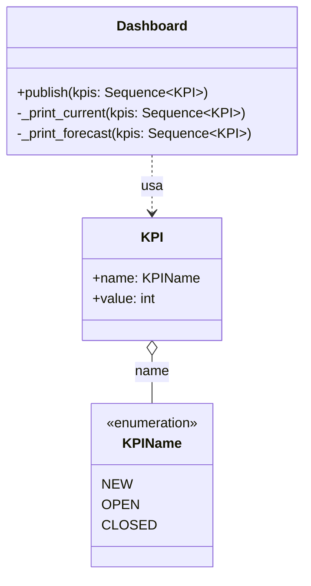
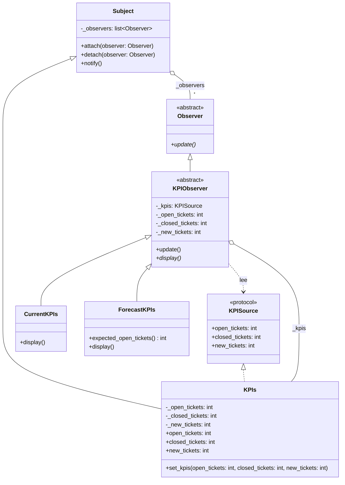

# Observer (de comportamiento)

> Cuando un objeto cambia, **avisale a todos los interesados** sin saber
> quiénes son ni cuántos hay.

## Archivos

| Archivo | Rol |
| --- | --- |
| [kpi_dashboard_before_observer.py](kpi_dashboard_before_observer.py) | Problema: `Dashboard.publish` llama a mano a cada consumidor de los `KPI`, y `_print_current` ramifica sobre `KPIName`. |
| [kpi_dashboard_with_observer.py](kpi_dashboard_with_observer.py) | Solución: `KPIs` es un `Subject` que notifica a sus `Observer`; `CurrentKPIs` y `ForecastKPIs` heredan de `KPIObserver` y leen los valores al recibir el aviso. |

```bash
uv run python -m behavioral.observer.kpi_dashboard_before_observer
uv run python -m behavioral.observer.kpi_dashboard_with_observer
```

La versión "con" publica tres rondas de valores y desconecta el pronóstico
antes de la última.

## El problema (antes)

```python
def publish(self, kpis: Sequence[KPI]) -> None:
    self._print_current(kpis)
    self._print_forecast(kpis)
```

- La fuente de los datos está acoplada a cada pantalla que los muestra.
- Una pantalla nueva es un método privado más y una llamada más en
  `publish`: la clase nunca queda cerrada.
- Los consumidores no se pueden agregar ni quitar en tiempo de ejecución.

## La solución (con el patrón)

```text
Subject ──notify()──▶ Observer.update()
   ▲                      ▲
 KPIs                 KPIObserver  ──lee valores de──▶ KPISource (Protocol)
                                                       ▲
                                                     KPIs
                          ▲
               CurrentKPIs | ForecastKPIs
```

- `Subject` guarda una lista de observers y los notifica en el orden en que
  se conectaron; itera sobre una copia, así que un observer puede
  desconectarse mientras lo notifican.
- Modelo *pull*: `notify()` solo avisa que algo cambió y cada observer lee
  lo que necesita.
- Una pantalla nueva es una clase nueva; ni el subject ni las otras
  pantallas cambian.

## Diagramas de clases

Un diagrama por archivo, en el orden de la tabla. Las relaciones:

- `<|--` herencia y `<|..` implementación de un `Protocol`.
- `*--` composición (la clase crea y posee el objeto) y `o--` agregación
  (lo recibe desde afuera); `"*"` indica una colección.
- `..>` dependencia: la clase lo `crea`, lo `usa` en una firma o lo `lanza`.
- En los miembros, `-` es privado, `*` abstracto y `$` de clase o estático.

### [kpi_dashboard_before_observer.py](kpi_dashboard_before_observer.py)



### [kpi_dashboard_with_observer.py](kpi_dashboard_with_observer.py)



## Patrón para reutilizar

1. Separá la fuente de los datos (subject) de quienes reaccionan a sus
   cambios (observers).
2. El subject expone `attach`, `detach` y `notify`, y llama a `notify` en
   cada cambio.
3. Elegí el modelo: *pull* (el observer consulta al subject) o *push* (el
   subject manda los datos en `update`).

Plantilla tipada: [PATTERNS.md → Observer](../../PATTERNS.md#observer).

**Precaución:** un observer que nunca se desconecta queda vivo mientras viva
el subject (*lapsed listener*), y un observer lento o que falla retrasa o
corta a los que vienen después.

## Simplificaciones del ejemplo

- La notificación es sincrónica y en el mismo hilo.
- Los observers reciben el subject por constructor pero el cliente los
  conecta a mano con `attach`.
