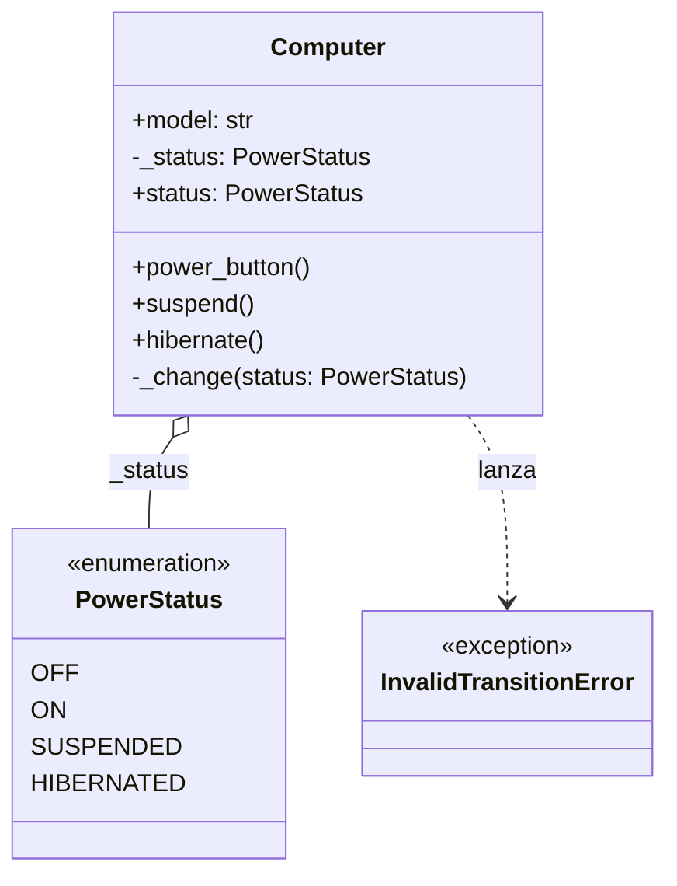
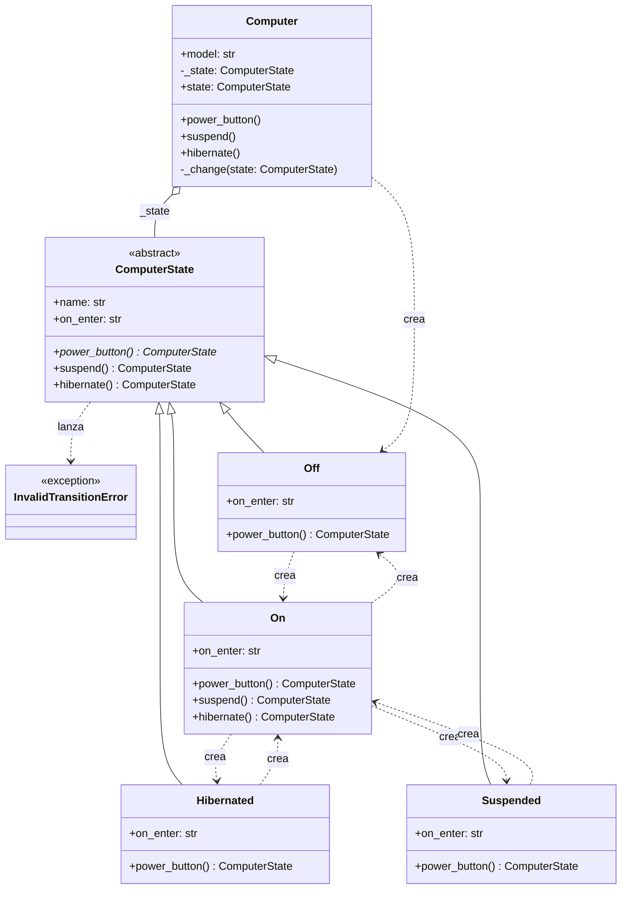

# State (de comportamiento)

> Cuando el comportamiento de un objeto depende de su estado, poné **cada
> estado en su propia clase** y dejá que el objeto delegue en el estado
> actual.

## Archivos

| Archivo | Rol |
| --- | --- |
| [state_power_before_state.py](state_power_before_state.py) | Problema: `Computer` ramifica cada acción sobre `PowerStatus` y lanza `InvalidTransitionError` en las transiciones prohibidas. |
| [state_power_with_state.py](state_power_with_state.py) | Solución: `ComputerState` define las acciones; `Off`, `On`, `Suspended` y `Hibernated` devuelven el estado siguiente y `Computer` solo delega. |

```bash
uv run python -m behavioral.state.state_power_before_state
uv run python -m behavioral.state.state_power_with_state
```

Las dos versiones recorren las mismas transiciones, incluida una
hibernación rechazada mientras la computadora está suspendida.

## El problema (antes)

```python
def power_button(self) -> None:
    if self._status == PowerStatus.OFF:
        self._change(PowerStatus.ON)
    elif self._status == PowerStatus.ON:
        self._change(PowerStatus.OFF)
    elif self._status in (PowerStatus.SUSPENDED, PowerStatus.HIBERNATED):
        self._change(PowerStatus.ON)
```

- El comportamiento de un estado está repartido entre todos los métodos.
- Un estado nuevo obliga a editar cada acción y a no olvidar ninguna rama.
- Las reglas de transición están implícitas en los `if`.

## La solución (con el patrón)

```text
Computer (Context) ──estado actual──▶ ComputerState
                                          ▲
                          Off | On | Suspended | Hibernated
```

- Cada acción del estado devuelve el estado siguiente, y `Computer` solo
  reemplaza el suyo.
- Las acciones que un estado no sobrescribe se rechazan en la clase base,
  así que las transiciones permitidas quedan explícitas en cada clase.

## Diagramas de clases

Un diagrama por archivo, en el orden de la tabla. Las relaciones:

- `<|--` herencia y `<|..` implementación de un `Protocol`.
- `*--` composición (la clase crea y posee el objeto) y `o--` agregación
  (lo recibe desde afuera); `"*"` indica una colección.
- `..>` dependencia: la clase lo `crea`, lo `usa` en una firma o lo `lanza`.
- En los miembros, `-` es privado, `*` abstracto y `$` de clase o estático.

### [state_power_before_state.py](state_power_before_state.py)



### [state_power_with_state.py](state_power_with_state.py)



## Patrón para reutilizar

1. Hacé una interfaz con una operación por acción del objeto.
2. Implementá un estado concreto por valor del antiguo enum.
3. El contexto guarda el estado actual y le delega cada acción.
4. Rechazá por defecto, en la clase base, las acciones que no aplican.

Plantilla tipada: [PATTERNS.md → State](../../PATTERNS.md#state).

**Precaución:** con dos estados triviales, un `if` es más claro. Además, los
estados conocen a sus sucesores, así que quedan acoplados entre sí.

## Simplificaciones del ejemplo

- Cada transición crea un estado nuevo (`On()`); como los estados no tienen
  campos, se podrían compartir como singletons.
- `model` no se usa en la lógica; está para que `Computer` se parezca a una
  entidad real.
