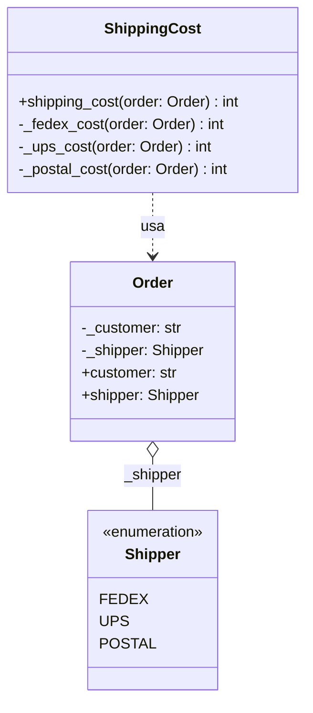
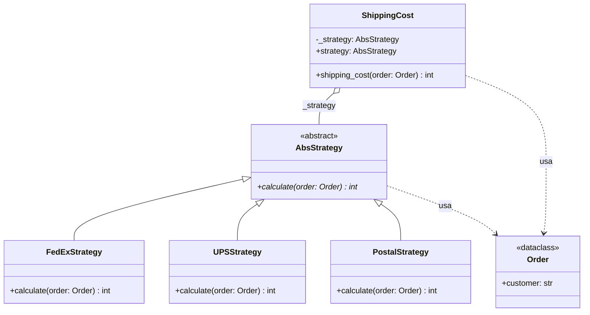

# Strategy (de comportamiento)

> Encapsulá cada **algoritmo intercambiable** en su propia clase y elegilo
> (o cambialo) en tiempo de ejecución.

## Archivos

| Archivo | Rol |
| --- | --- |
| [shipping_cost_before_strategy.py](shipping_cost_before_strategy.py) | Problema: `Order` guarda su `Shipper` y `ShippingCost` ramifica sobre él para calcular el costo. |
| [shipping_cost_with_strategy.py](shipping_cost_with_strategy.py) | Solución: `ShippingCost` delega en un `AbsStrategy` inyectado (`FedExStrategy`, `UPSStrategy`, `PostalStrategy`); `Order` solo describe el pedido. |

```bash
uv run python -m behavioral.strategy.shipping_cost_before_strategy
uv run python -m behavioral.strategy.shipping_cost_with_strategy
```

Los costos están en centavos `int`.

## El problema (antes)

```python
def shipping_cost(self, order: Order) -> int:
    if order.shipper == Shipper.FEDEX:
        return self._fedex_cost(order)
    if order.shipper == Shipper.UPS:
        return self._ups_cost(order)
    if order.shipper == Shipper.POSTAL:
        return self._postal_cost(order)
    raise ValueError(f"Invalid shipper {order.shipper}")
```

- `Order` mezcla qué se pide con cómo viaja.
- Una empresa nueva es una rama nueva y un método nuevo en la misma clase.
- Los algoritmos no se pueden testear, reutilizar ni cambiar por separado.

## La solución (con el patrón)

```text
ShippingCost (Context) ──▶ AbsStrategy
                               ▲
          FedExStrategy | UPSStrategy | PostalStrategy
```

- Cada algoritmo vive en su clase; `ShippingCost` no cambia al agregar una
  empresa.
- La estrategia se recibe por constructor y se puede reemplazar con el
  setter `strategy`.

## Diagramas de clases

Un diagrama por archivo, en el orden de la tabla. Las relaciones:

- `<|--` herencia y `<|..` implementación de un `Protocol`.
- `*--` composición (la clase crea y posee el objeto) y `o--` agregación
  (lo recibe desde afuera); `"*"` indica una colección.
- `..>` dependencia: la clase lo `crea`, lo `usa` en una firma o lo `lanza`.
- En los miembros, `-` es privado, `*` abstracto y `$` de clase o estático.

### [shipping_cost_before_strategy.py](shipping_cost_before_strategy.py)



### [shipping_cost_with_strategy.py](shipping_cost_with_strategy.py)



## Patrón para reutilizar

1. Identificá el `if/elif` que elige un algoritmo según un código de tipo.
2. Convertí cada rama en una clase que implementa una interfaz común.
3. El contexto recibe la estrategia por constructor y le delega el
   cálculo.
4. Quien elige la estrategia es el cliente (o la composition root), no el
   contexto.

Plantilla tipada: [PATTERNS.md → Strategy](../../PATTERNS.md#strategy).

**Precaución:** si las estrategias son funciones puras sin estado, en Python
alcanza con pasar un `Callable[[Order], int]`.

## Simplificaciones del ejemplo

- Las tarifas son fijas; las estrategias reciben el `Order` pero no lo
  usan. En un caso real dependerían del peso, el destino o la urgencia.
