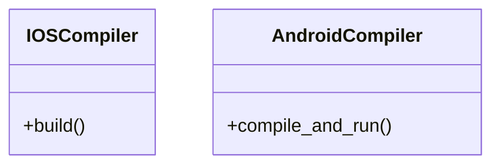
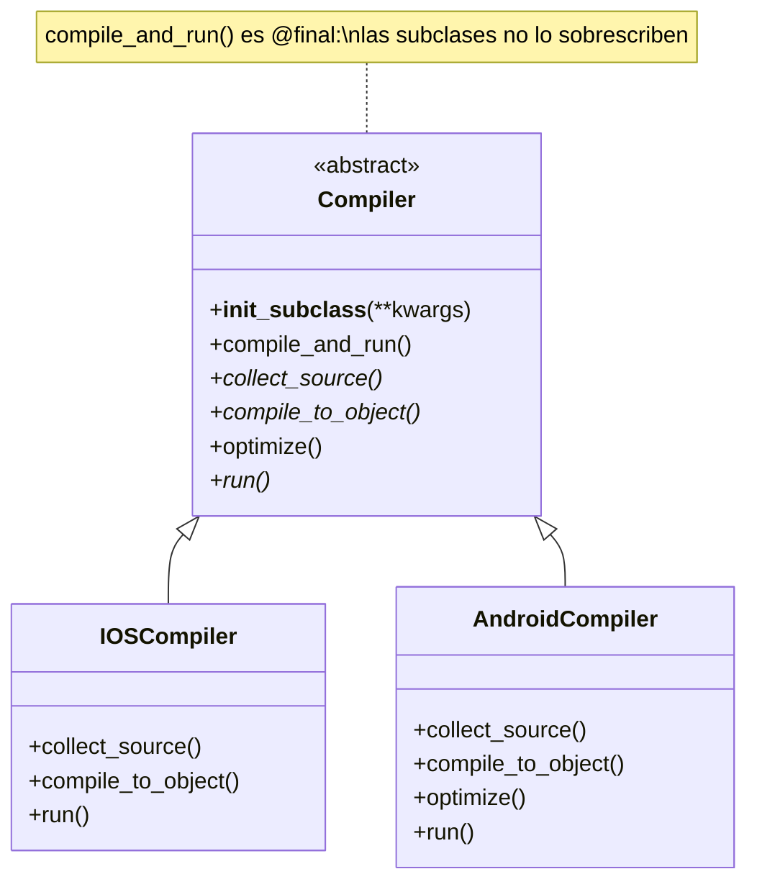
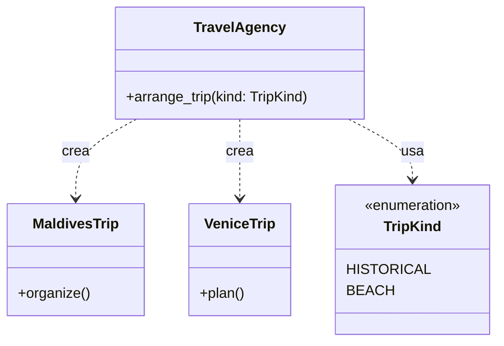
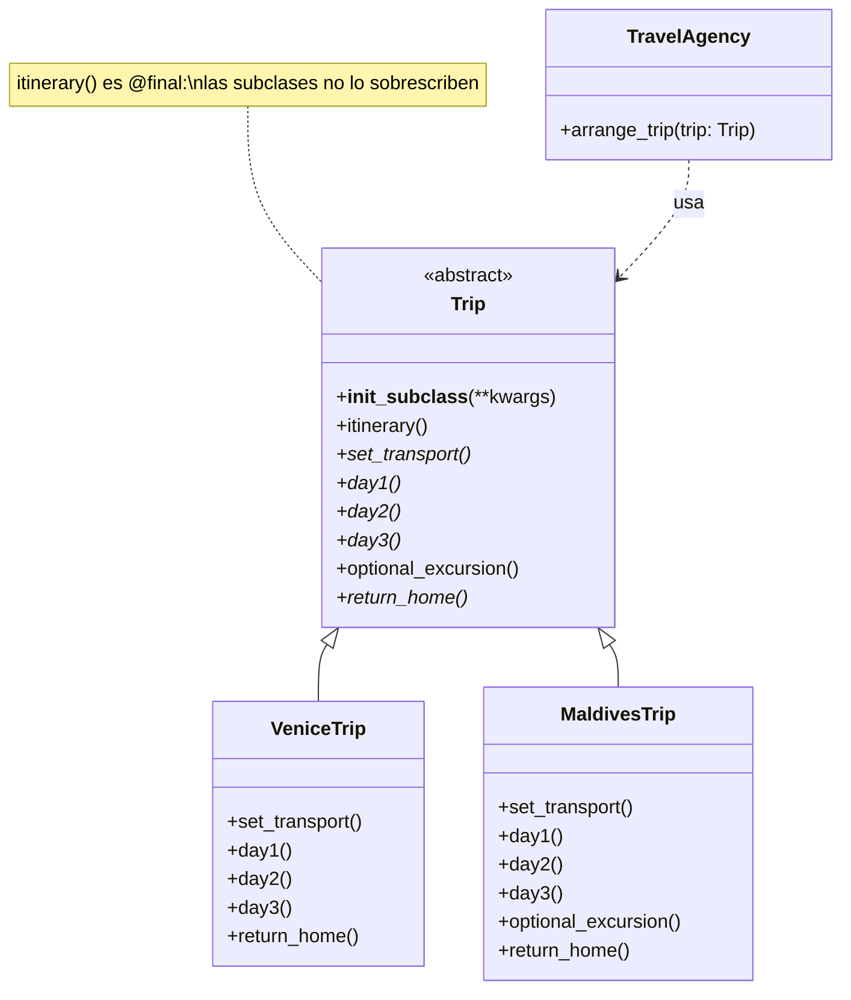

# Template Method (de comportamiento)

> Definí **el esqueleto de un algoritmo una sola vez** en la clase base y
> dejá que las subclases completen solo los pasos que cambian.

## Archivos

Hay dos ejemplos independientes: compiladores y paquetes de viaje.

| Archivo | Rol |
| --- | --- |
| [compiler_before_template_method.py](compiler_before_template_method.py) | Problema: `IOSCompiler.build()` y `AndroidCompiler.compile_and_run()` copian el mismo pipeline con nombres distintos. |
| [compiler_with_template_method.py](compiler_with_template_method.py) | Solución: `Compiler.compile_and_run()` fija el pipeline; `IOSCompiler` y `AndroidCompiler` implementan los pasos, y solo Android sobrescribe el hook `optimize`. |
| [travel_agency_before_template_method.py](travel_agency_before_template_method.py) | Problema: `VeniceTrip.plan()` y `MaldivesTrip.organize()` repiten el itinerario, y `TravelAgency` ramifica sobre `TripKind`. |
| [travel_agency_with_template_method.py](travel_agency_with_template_method.py) | Solución: `Trip.itinerary()` fija el itinerario; `VeniceTrip` y `MaldivesTrip` completan los días, y solo `MaldivesTrip` sobrescribe el hook `optional_excursion`; `TravelAgency` acepta cualquier `Trip`. |

```bash
uv run python -m behavioral.template_method.compiler_before_template_method
uv run python -m behavioral.template_method.compiler_with_template_method
uv run python -m behavioral.template_method.travel_agency_before_template_method
uv run python -m behavioral.template_method.travel_agency_with_template_method
```

## El problema (antes)

```text
IOSCompiler.build()              AndroidCompiler.compile_and_run()
  collect → compile → run          collect → compile → shrink → run
  (mismo esqueleto, escrito dos veces, libre de desviarse)

TravelAgency.arrange_trip(kind)
  if HISTORICAL → VeniceTrip.plan()        transporte → días → regreso
  elif BEACH    → MaldivesTrip.organize()  transporte → días → regreso
  (mismo itinerario copiado a mano; el cliente ramifica sobre TripKind)
```

- Cambiar el pipeline (o el itinerario) obliga a editar cada clase y
  mantenerlas iguales a mano.
- Nada impide que una clase nueva saltee un paso o los ejecute en otro
  orden.
- No hay un punto de entrada común: el cliente tiene que conocer el nombre
  del método de cada clase.
- En la agencia, además, cada destino nuevo obliga a agregar un valor a
  `TripKind` y una rama a `TravelAgency.arrange_trip`.

## La solución (con el patrón)

```text
Compiler.compile_and_run()   ← template method, no se puede sobrescribir
  collect_source() → compile_to_object() → optimize() → run()
                                           (hook)
        ▲                         ▲
  IOSCompiler            AndroidCompiler (sobrescribe el hook)

TravelAgency.arrange_trip(trip) ──► Trip.itinerary()   ← template method
  set_transport() → day1() → day2() → day3() → optional_excursion() → return_home()
                                                (hook)
        ▲                         ▲
   VeniceTrip            MaldivesTrip (sobrescribe el hook)
```

- El template method está marcado con `@final` para mypy, y
  `__init_subclass__` lanza `TypeError` si una subclase lo sobrescribe.
- Los pasos obligatorios son abstractos; los opcionales son *hooks* con una
  implementación vacía por defecto.
- La agencia recibe cualquier `Trip` y llama a `itinerary()`: ya no hay
  `TripKind` ni ramas, y un destino nuevo es solo una subclase más.

## Diagramas de clases

Un diagrama por archivo, en el orden de la tabla. Las relaciones:

- `<|--` herencia y `<|..` implementación de un `Protocol`.
- `*--` composición (la clase crea y posee el objeto) y `o--` agregación
  (lo recibe desde afuera); `"*"` indica una colección.
- `..>` dependencia: la clase lo `crea`, lo `usa` en una firma o lo `lanza`.
- En los miembros, `-` es privado, `*` abstracto y `$` de clase o estático.

### [compiler_before_template_method.py](compiler_before_template_method.py)



### [compiler_with_template_method.py](compiler_with_template_method.py)



### [travel_agency_before_template_method.py](travel_agency_before_template_method.py)



### [travel_agency_with_template_method.py](travel_agency_with_template_method.py)



## Patrón para reutilizar

1. Escribí la secuencia de pasos en un método de la clase base.
2. Marcá abstractos los pasos que cada subclase debe implementar, y dejá
   como hooks vacíos los opcionales.
3. Impedí que se sobrescriba el template method (`@final` y, si querés que
   falle en tiempo de ejecución, `__init_subclass__`).
4. Los clientes llaman siempre al template method.

Plantilla tipada: [PATTERNS.md → Template Method](../../PATTERNS.md#template-method).

**Precaución:** el esqueleto queda fijo por herencia y no se puede cambiar en
tiempo de ejecución. Si necesitás cambiar el algoritmo entero, usá Strategy.

## Simplificaciones del ejemplo

- Los pasos solo imprimen mensajes.
- La versión "con" de la agencia agrega una excursión opcional que la
  versión "antes" no tenía, para mostrar el hook.
