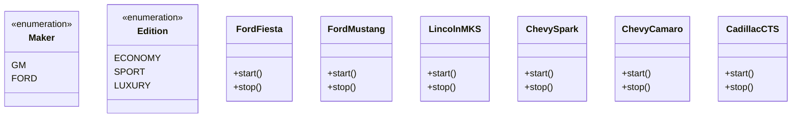
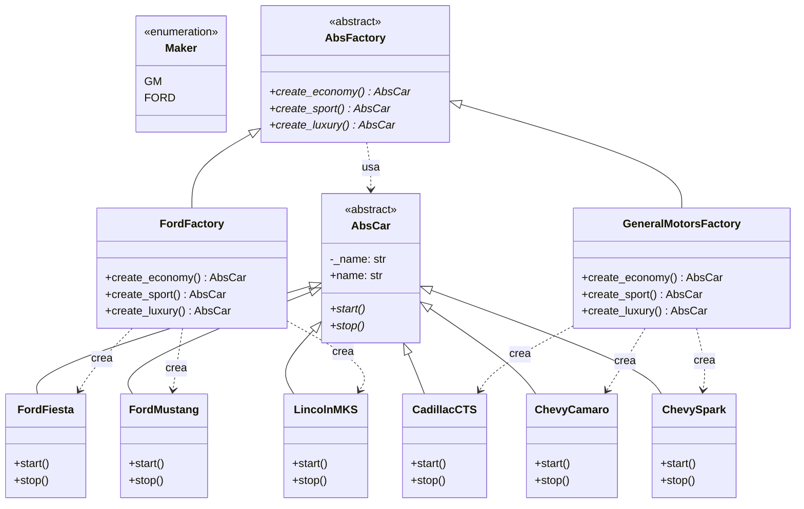

# Abstract Factory (creacional)

> Una fábrica por **familia de productos relacionados**: el cliente elige la
> familia eligiendo la fábrica, y nunca nombra una clase concreta.

## Archivos

| Archivo | Rol |
| --- | --- |
| [cars_before_abstract_factory.py](cars_before_abstract_factory.py) | Problema: `make_car` decide con un `if/elif` anidado sobre `Maker` y `Edition`, y el único tipo común es `Car`, la unión de todas las clases concretas. |
| [cars_with_abstract_factory.py](cars_with_abstract_factory.py) | Solución: `AbsFactory` declara `create_economy`, `create_sport` y `create_luxury`; `FordFactory` y `GeneralMotorsFactory` fabrican cada una su familia de `AbsCar`. |

```bash
uv run python -m creational.abstract_factory.cars_before_abstract_factory
uv run python -m creational.abstract_factory.cars_with_abstract_factory
```

Las dos versiones arrancan y detienen los seis autos: tres ediciones de Ford
(`FordFiesta`, `FordMustang`, `LincolnMKS`) y tres de General Motors
(`ChevySpark`, `ChevyCamaro`, `CadillacCTS`).

## El problema (antes)

```python
def make_car(maker: Maker, edition: Edition) -> Car:
    if maker == Maker.GM:
        if edition == Edition.ECONOMY:
            return ChevySpark()
        ...
    if maker == Maker.FORD:
        if edition == Edition.ECONOMY:
            return FordFiesta()
        ...
    raise ValueError(f"Unknown car: maker={maker}, edition={edition}")
```

- El cliente conoce todas las clases concretas; `Car` crece con cada modelo.
- Un fabricante o una edición nueva obliga a editar el `if/elif` anidado.
- Nada agrupa los autos por familia: es fácil mezclar un Ford económico con
  un GM de lujo por error.

## La solución (con el patrón)

```text
drive_lineup(factory) ──usa──▶ AbsFactory ──crea──▶ AbsCar
                                   ▲                   ▲
                FordFactory | GeneralMotorsFactory     │
                                                       ├── FordFiesta | FordMustang | LincolnMKS
                                                       └── ChevySpark | ChevyCamaro | CadillacCTS
```

- El cliente (`drive_lineup`) solo conoce `AbsFactory` y `AbsCar`.
- Cada fábrica concreta produce **toda** su familia, así que no hay mezclas.
- `factory_for` elige la fábrica en tiempo de ejecución desde `FACTORIES`, a
  partir de un `Maker` o de su clave (`"ford"`, `"gm"`).

## Diagramas de clases

Un diagrama por archivo, en el orden de la tabla. Las relaciones:

- `<|--` herencia y `<|..` implementación de un `Protocol`.
- `*--` composición (la clase crea y posee el objeto) y `o--` agregación
  (lo recibe desde afuera); `"*"` indica una colección.
- `..>` dependencia: la clase lo `crea`, lo `usa` en una firma o lo `lanza`.
- En los miembros, `-` es privado, `*` abstracto y `$` de clase o estático.

### [cars_before_abstract_factory.py](cars_before_abstract_factory.py)



### [cars_with_abstract_factory.py](cars_with_abstract_factory.py)



## Patrón para reutilizar

1. Identificá las familias (fabricante, tema visual, proveedor de base de
   datos) y los productos que cada una ofrece.
2. Declará una interfaz por producto y una fábrica abstracta con un
   `create_*` por producto.
3. Implementá una fábrica concreta por familia.
4. El cliente recibe la fábrica y solo usa las interfaces.

Plantilla tipada: [PATTERNS.md → Abstract Factory](../../PATTERNS.md#abstract-factory).

**Precaución:** agregar un **tipo de producto** nuevo (por ejemplo, una
edición pickup) obliga a cambiar `AbsFactory` y todas las fábricas. El
patrón brilla cuando crecen las familias, no los productos.

## Simplificaciones del ejemplo

- Los autos solo imprimen mensajes en `start` y `stop`; no hay estado real.
- Las fábricas no tienen estado, por eso se crean una vez en `FACTORIES` y
  se reutilizan.
