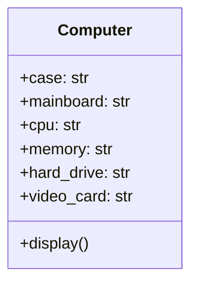
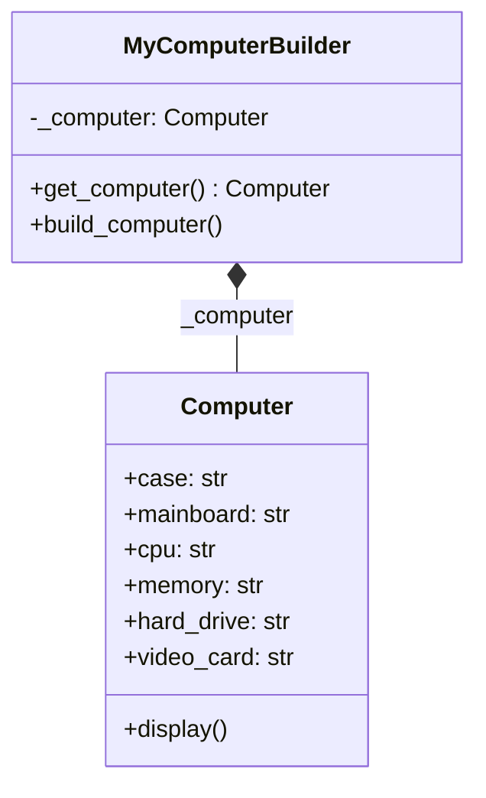
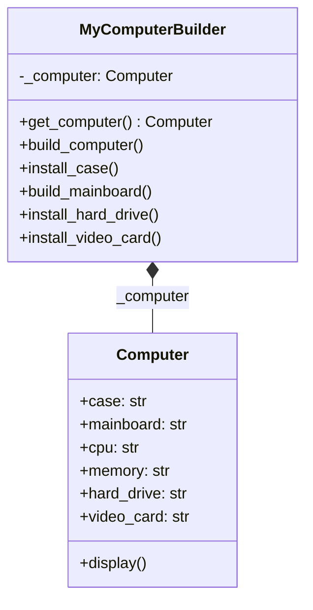
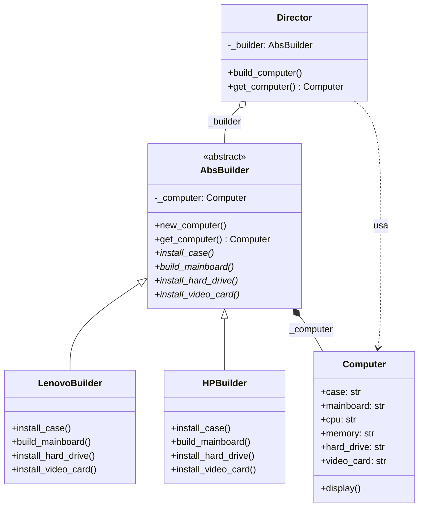

# Builder (creacional)

> Separá **cómo** se arma un objeto (el orden de los pasos) de **qué** piezas
> lleva: el `Director` define la secuencia y cada builder decide los
> componentes.

## Archivos

El ejemplo recorre cinco pasos con el mismo `Computer`.

| Archivo | Rol |
| --- | --- |
| [computer_long_constructor_before_builder.py](computer_long_constructor_before_builder.py) | Paso 1: `Computer` recibe seis argumentos en el constructor. |
| [computer_public_attributes_before_builder.py](computer_public_attributes_before_builder.py) | Paso 2: el cliente asigna atributos públicos uno por uno. |
| [computer_encapsulated_before_builder.py](computer_encapsulated_before_builder.py) | Paso 3: `MyComputerBuilder` encapsula la asignación, pero en un orden arbitrario. |
| [computer_build_before_builder.py](computer_build_before_builder.py) | Paso 4: `MyComputerBuilder` impone el orden con un método por paso, pero solo sirve para una configuración. |
| [computer_with_builder.py](computer_with_builder.py) | Paso 5, solución: `Director` ejecuta los pasos de `AbsBuilder`; `LenovoBuilder` y `HPBuilder` eligen las piezas. |

```bash
uv run python -m creational.builder.computer_long_constructor_before_builder
uv run python -m creational.builder.computer_public_attributes_before_builder
uv run python -m creational.builder.computer_encapsulated_before_builder
uv run python -m creational.builder.computer_build_before_builder
uv run python -m creational.builder.computer_with_builder
```

## El problema (antes)

Cada paso arregla el problema del anterior y deja ver el siguiente:

```text
Paso 1  Computer(case, mainboard, cpu, memory, hard_drive, video_card)
        → lista de parámetros larga, crece con cada componente
Paso 2  computer.case = ... ; computer.mainboard = ...
        → sin encapsulación: el cliente puede olvidar una pieza
Paso 3  MyComputerBuilder.build_computer() asigna todo junto
        → nada expresa el orden de armado
Paso 4  install_case() → build_mainboard() → install_hard_drive() → ...
        → el orden está, pero otra configuración obliga a copiar la clase
```

En el paso 4, la secuencia (cómo armar) y los componentes (qué armar) viven
en la misma clase, así que no pueden variar por separado.

## La solución (con el patrón)

```text
client ──▶ Director ──usa──▶ AbsBuilder ──arma──▶ Computer
           build_computer()      ▲
                     LenovoBuilder | HPBuilder
```

- `Director.build_computer()` llama siempre los mismos pasos, en el mismo
  orden, para cualquier builder.
- `AbsBuilder` declara los pasos y guarda el producto en construcción;
  `new_computer()` arranca cada armado desde cero.
- Una configuración nueva es un builder nuevo: ni el director ni los otros
  builders cambian.

## Diagramas de clases

Un diagrama por archivo, en el orden de la tabla. Las relaciones:

- `<|--` herencia y `<|..` implementación de un `Protocol`.
- `*--` composición (la clase crea y posee el objeto) y `o--` agregación
  (lo recibe desde afuera); `"*"` indica una colección.
- `..>` dependencia: la clase lo `crea`, lo `usa` en una firma o lo `lanza`.
- En los miembros, `-` es privado, `*` abstracto y `$` de clase o estático.

### [computer_long_constructor_before_builder.py](computer_long_constructor_before_builder.py)



### [computer_public_attributes_before_builder.py](computer_public_attributes_before_builder.py)


### [computer_encapsulated_before_builder.py](computer_encapsulated_before_builder.py)



### [computer_build_before_builder.py](computer_build_before_builder.py)



### [computer_with_builder.py](computer_with_builder.py)



## Patrón para reutilizar

1. Identificá los pasos de construcción y el orden en que deben ejecutarse.
2. Declará un builder abstracto con un método por paso y otro para obtener
   el resultado.
3. Poné la secuencia en un director (o en una función) que reciba el
   builder.
4. Cada representación distinta del producto es un builder concreto.

Plantilla tipada: [PATTERNS.md → Builder](../../PATTERNS.md#builder).

**Precaución:** si el objeto solo tiene muchos campos opcionales y no hay
un orden que respetar, un `dataclass` con argumentos por nombre suele
alcanzar.

## Simplificaciones del ejemplo

- Los componentes son strings; un armado real validaría compatibilidades
  (por ejemplo, que la CPU entre en el mainboard).
- `get_computer()` devuelve el producto aunque el armado no haya terminado;
  en código real conviene que el director sea el único que lo entregue.
