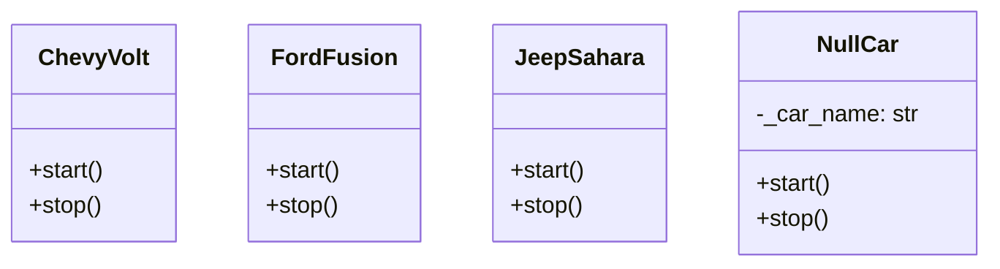
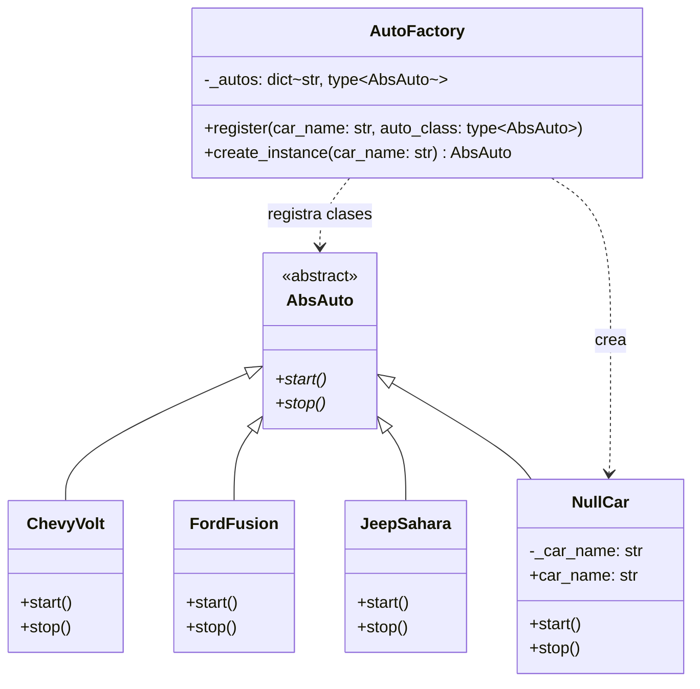
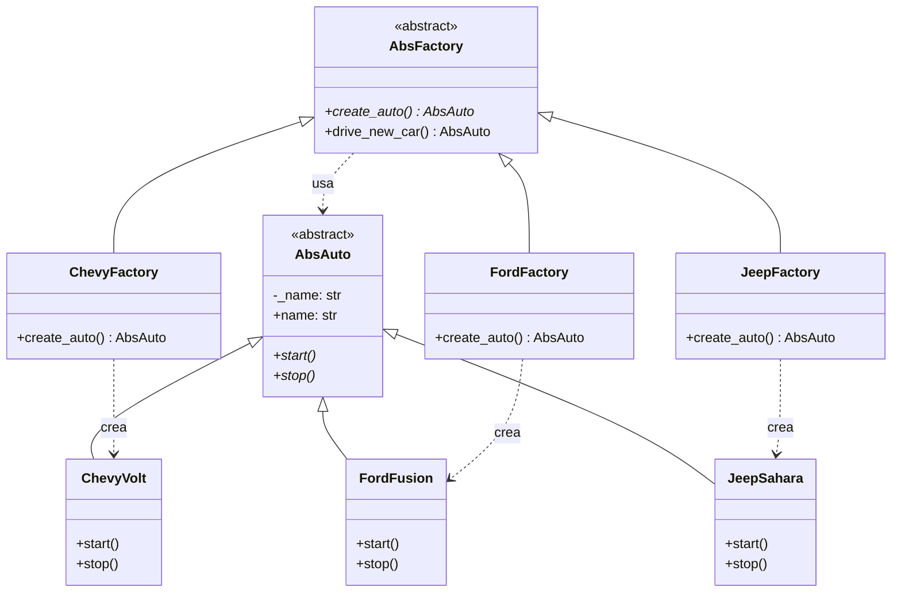

# Factory: Simple Factory y Factory Method (creacional)

> Sacá la creación de objetos del cliente: el cliente pide un producto y
> recibe una abstracción, sin saber qué clase concreta se instanció.

## Archivos

| Archivo | Rol |
| --- | --- |
| [cars_before_factory.py](cars_before_factory.py) | Paso 1, problema: `get_car` elige entre `ChevyVolt`, `FordFusion` y `JeepSahara` con un `if/elif`; los nombres desconocidos devuelven un `NullCar`. |
| [cars_with_simple_factory.py](cars_with_simple_factory.py) | Paso 2, Simple Factory: `AutoFactory` guarda un registro nombre → clase de `AbsAuto`; un nombre desconocido devuelve `NullCar`. |
| [cars_with_factory_method.py](cars_with_factory_method.py) | Paso 3, Factory Method: `AbsFactory.create_auto()` es el método fábrica; `ChevyFactory`, `FordFactory` y `JeepFactory` deciden qué auto crear. |

```bash
uv run python -m creational.factory.cars_before_factory
uv run python -m creational.factory.cars_with_simple_factory
uv run python -m creational.factory.cars_with_factory_method
```

Los tres pasos usan las claves `"chevy"`, `"ford"` y `"jeep"`, y piden
también un `"tesla"` que no existe para mostrar cómo se maneja.

## El problema (antes)

```python
def get_car(car_name: str) -> Car:
    if car_name == "chevy":
        return ChevyVolt()
    if car_name == "ford":
        return FordFusion()
    if car_name == "jeep":
        return JeepSahara()
    return NullCar(car_name)
```

- Agregar un modelo obliga a abrir el módulo y editar `get_car`.
- El programa instancia las clases concretas; `Car` es solo la unión de
  todas.

## La solución (con el patrón)

```text
Paso 2  client ──▶ AutoFactory.create_instance(name) ──▶ AbsAuto
                     _autos: dict[str, type[AbsAuto]]
                     nombre desconocido → NullCar

Paso 3  client ──▶ load_factory(name) ──▶ AbsFactory.create_auto()  ← factory method
                                              ▲
                              ChevyFactory | FordFactory | JeepFactory
```

- **Simple Factory:** un único lugar sabe crear cada producto. Agregar un
  auto es una subclase de `AbsAuto` más un `register` en
  `default_auto_factory`; `AutoFactory` no cambia.
- **Factory Method:** cada fábrica concreta decide cómo se crea su producto
  (nombre, configuración, validación). `drive_new_car` es un template method
  cuyo paso variable es el método fábrica.

## Diagramas de clases

Un diagrama por archivo, en el orden de la tabla. Las relaciones:

- `<|--` herencia y `<|..` implementación de un `Protocol`.
- `*--` composición (la clase crea y posee el objeto) y `o--` agregación
  (lo recibe desde afuera); `"*"` indica una colección.
- `..>` dependencia: la clase lo `crea`, lo `usa` en una firma o lo `lanza`.
- En los miembros, `-` es privado, `*` abstracto y `$` de clase o estático.

### [cars_before_factory.py](cars_before_factory.py)



### [cars_with_simple_factory.py](cars_with_simple_factory.py)



### [cars_with_factory_method.py](cars_with_factory_method.py)



## Patrón para reutilizar

1. Si todos los productos se crean igual, usá una Simple Factory con un
   registro explícito (`dict[str, type[Product]]`), sin `eval` ni
   introspección de módulos.
2. Si cada producto necesita su propia lógica de creación, declará un
   método fábrica abstracto y una subclase creadora por producto.
3. Decidí qué pasa con una clave desconocida: un Null Object (paso 2) o un
   error que liste las claves válidas (paso 3).

Plantillas tipadas: [PATTERNS.md → Factory Method](../../PATTERNS.md#factory-method).

**Precaución:** si nunca va a haber más de dos productos, un `if` simple es
más claro que cualquier fábrica.

## Simplificaciones del ejemplo

- Los autos solo imprimen mensajes; no tienen estado.
- En el paso 3 cada fábrica crea un único producto con un nombre fijo; en
  la práctica la lógica de creación es lo que justifica una fábrica por
  producto.
- `NullCar` es un ejemplo de Null Object: cumple la interfaz para que el
  cliente nunca tenga que preguntar por `None`.
