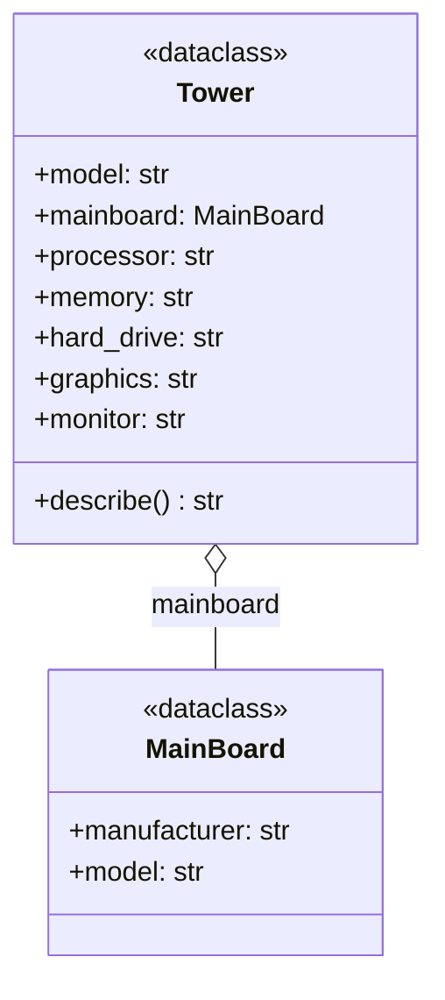
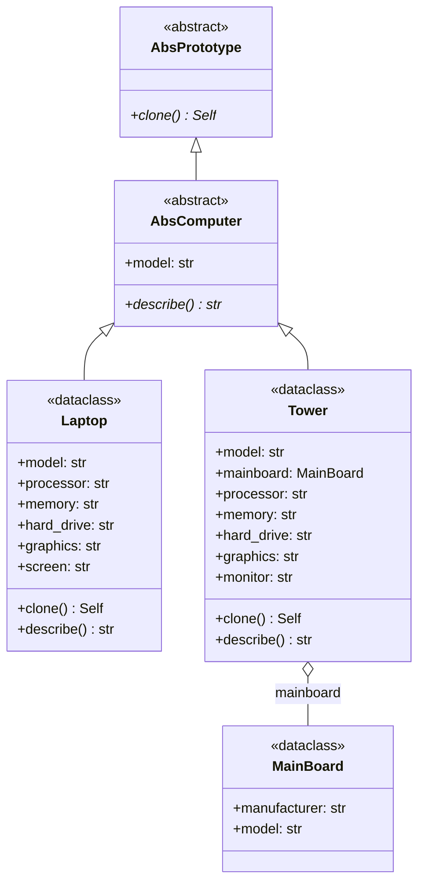
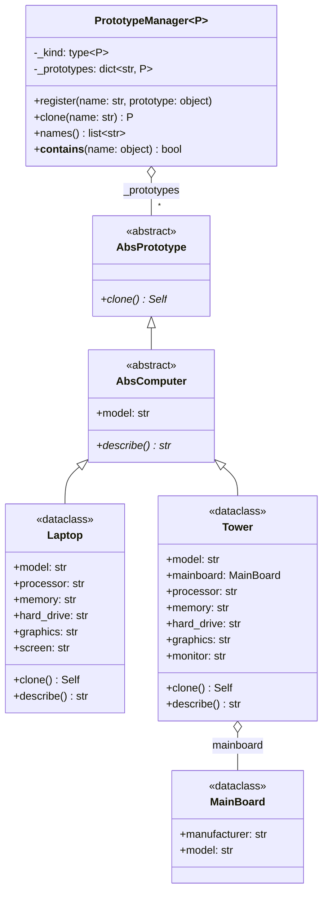

# Prototype (creacional)

> Creá objetos nuevos **copiando uno ya configurado**, en lugar de repetir
> todos los argumentos del constructor.

## Archivos

| Archivo | Rol |
| --- | --- |
| [computer_before_prototype.py](computer_before_prototype.py) | Problema: cada variante de `Tower` repite los siete argumentos, incluido el `MainBoard` anidado. |
| [computer_with_shallow_copy_prototype.py](computer_with_shallow_copy_prototype.py) | Variante superficial: `clone()` usa `copy.copy`. Es seguro para `Laptop` (solo strings), pero `Tower` comparte su `MainBoard` con el clon. |
| [computer_with_deep_copy_prototype.py](computer_with_deep_copy_prototype.py) | Variante profunda: `clone()` usa `copy.deepcopy` y cada clon tiene su propio `MainBoard`. |
| [computer_with_registry_prototype.py](computer_with_registry_prototype.py) | Registro: `PrototypeManager` guarda presets con nombre y entrega clones; valida que lo registrado sea un `AbsComputer`. |

```bash
uv run python -m creational.prototype.computer_before_prototype
uv run python -m creational.prototype.computer_with_shallow_copy_prototype
uv run python -m creational.prototype.computer_with_deep_copy_prototype
uv run python -m creational.prototype.computer_with_registry_prototype
```

La variante superficial imprime a propósito la "sorpresa": cambiar el
mainboard del clon también cambia el del original.

## El problema (antes)

```python
renamed = Tower(
    model="T2",
    mainboard=MainBoard(manufacturer="ASUS", model="Game"),
    processor="AMD",
    memory="32GB",
    ...
)
```

- El cliente necesita la clase concreta y todos sus argumentos para obtener
  "lo mismo, pero un poco distinto".
- Cuando `Tower` gana un campo, hay que editar cada copia escrita a mano.
- Copiar campo por campo es fácil de hacer mal: reusar
  `original.mainboard` hace que dos torres compartan el mismo objeto.

## La solución (con el patrón)

```text
Client ──▶ AbsPrototype.clone()
                ▲
           AbsComputer
                ▲
         Laptop | Tower ──▶ MainBoard   (compartido con copy.copy,
                                         propio con copy.deepcopy)

Client ──▶ PrototypeManager.clone("gaming-tower") ──▶ prototype.clone()
```

- `clone()` devuelve `Self`, así que el clon conserva su tipo concreto.
- La copia profunda resuelve el estado mutable compartido; su memo también
  reproduce referencias compartidas y ciclos.
- El registro permite agregar presets en tiempo de ejecución sin tocar a
  los clientes.

## Diagramas de clases

Un diagrama por archivo, en el orden de la tabla. Las relaciones:

- `<|--` herencia y `<|..` implementación de un `Protocol`.
- `*--` composición (la clase crea y posee el objeto) y `o--` agregación
  (lo recibe desde afuera); `"*"` indica una colección.
- `..>` dependencia: la clase lo `crea`, lo `usa` en una firma o lo `lanza`.
- En los miembros, `-` es privado, `*` abstracto y `$` de clase o estático.

### [computer_before_prototype.py](computer_before_prototype.py)



### [computer_with_shallow_copy_prototype.py](computer_with_shallow_copy_prototype.py)



### [computer_with_deep_copy_prototype.py](computer_with_deep_copy_prototype.py)


### [computer_with_registry_prototype.py](computer_with_registry_prototype.py)



## Patrón para reutilizar

1. Declará un `clone() -> Self` en la interfaz del prototipo.
2. Elegí el tipo de copia según el estado: `copy.copy` si todo es inmutable,
   `copy.deepcopy` si hay partes mutables.
3. Si hay objetos que no se pueden o no se deben copiar (archivos, locks,
   cachés), definí `__deepcopy__` para decidir qué se copia y qué se
   comparte.
4. Si los clientes piden configuraciones por nombre, agregá un registro que
   valide lo que guarda.

Plantilla tipada: [PATTERNS.md → Prototype](../../PATTERNS.md#prototype).

## Simplificaciones del ejemplo

- Construir un `Tower` es barato; el patrón rinde más cuando configurar el
  objeto es costoso (probar hardware, cargar drivers).
- `PrototypeManager.clone` entrega lo que devuelva el `clone()` del
  prototipo; en este módulo todos los presets usan copia profunda.
