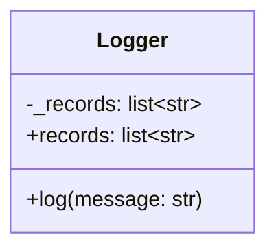
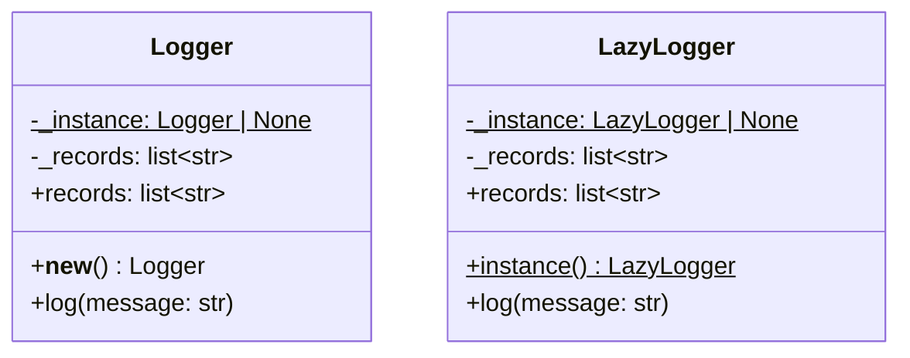
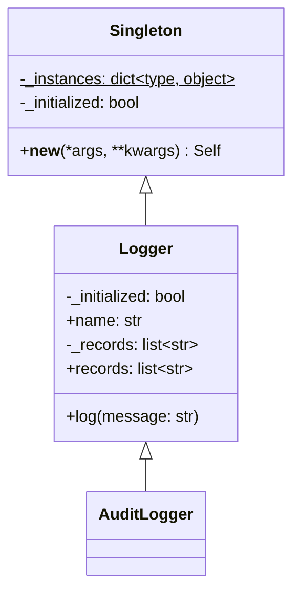
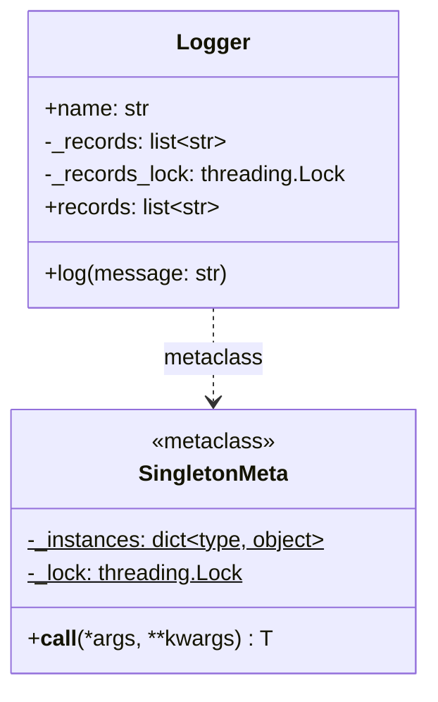
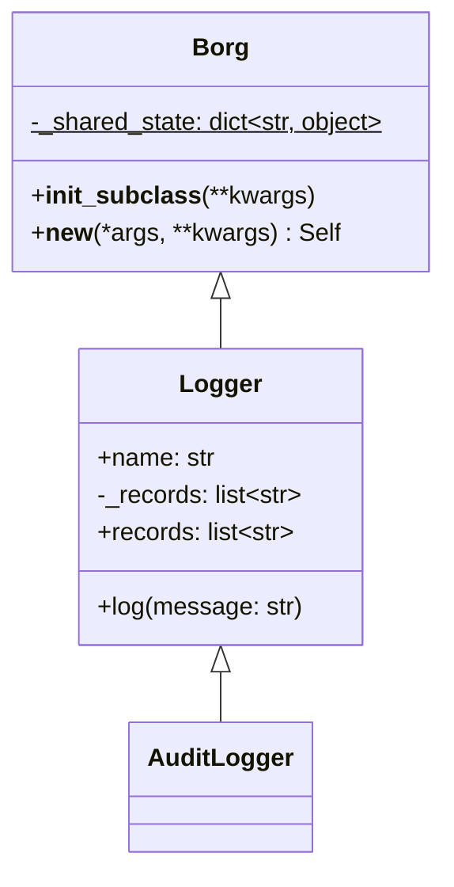

# Singleton (creacional)

> Garantizá **una sola instancia** (o un solo estado) y un punto de acceso
> global a ella.

## Archivos

| Archivo | Rol |
| --- | --- |
| [logger_before_singleton.py](logger_before_singleton.py) | Problema: cada módulo crea su propio `Logger` y el log de un checkout queda partido en dos buffers. |
| [logger_with_classic_singleton.py](logger_with_classic_singleton.py) | Clásico: `Logger` sobrescribe `__new__`; `LazyLogger` usa un `instance()` perezoso, al estilo GoF. |
| [logger_with_base_class_singleton.py](logger_with_base_class_singleton.py) | Clase base: `Singleton` guarda una instancia por subclase, así que `Logger` y `AuditLogger` tienen una cada una. |
| [logger_with_metaclass_singleton.py](logger_with_metaclass_singleton.py) | Metaclase: `SingletonMeta.__call__` crea la instancia una sola vez, con un lock y doble verificación (thread-safe). |
| [logger_with_monostate_singleton.py](logger_with_monostate_singleton.py) | Monostate (Borg): `Borg` hace que todas las instancias compartan el mismo `__dict__`; los objetos son distintos pero el estado es uno. |

```bash
uv run python -m creational.singleton.logger_before_singleton
uv run python -m creational.singleton.logger_with_classic_singleton
uv run python -m creational.singleton.logger_with_base_class_singleton
uv run python -m creational.singleton.logger_with_metaclass_singleton
uv run python -m creational.singleton.logger_with_monostate_singleton
```

## El problema (antes)

```text
order module   ──▶ Logger() #1 ──▶ buffer A: "order created", "order confirmed"
payment module ──▶ Logger() #2 ──▶ buffer B: "card charged"
```

- Quien lee un logger ve la mitad de la historia, y nada en el código avisa
  que hay un segundo buffer.
- Con archivos reales es peor: dos handles en modo escritura sobre el mismo
  archivo se pisan.
- Pasar un único logger a todas las funciones lo arregla, pero ensucia cada
  firma del camino.

## La solución (con el patrón)

| Variante | Qué se comparte | `__init__` en llamadas repetidas | Thread-safe |
| --- | --- | --- | --- |
| Clásica (`__new__`) | Identidad | No hay `__init__`: el estado se crea en `__new__` | No |
| Clásica (`instance()`) | Identidad, por convención | Solo la primera vez | No |
| Clase base | Identidad, una por subclase | Se ejecuta siempre: necesita una guarda | No |
| Metaclase | Identidad, una por clase | Solo la primera vez | Sí |
| Monostate (Borg) | Estado (`__dict__`), no identidad | Se ejecuta siempre: necesita una guarda | No |

## Diagramas de clases

Un diagrama por archivo, en el orden de la tabla. Las relaciones:

- `<|--` herencia y `<|..` implementación de un `Protocol`.
- `*--` composición (la clase crea y posee el objeto) y `o--` agregación
  (lo recibe desde afuera); `"*"` indica una colección.
- `..>` dependencia: la clase lo `crea`, lo `usa` en una firma o lo `lanza`.
- En los miembros, `-` es privado, `*` abstracto y `$` de clase o estático.

### [logger_before_singleton.py](logger_before_singleton.py)



### [logger_with_classic_singleton.py](logger_with_classic_singleton.py)



### [logger_with_base_class_singleton.py](logger_with_base_class_singleton.py)



### [logger_with_metaclass_singleton.py](logger_with_metaclass_singleton.py)



### [logger_with_monostate_singleton.py](logger_with_monostate_singleton.py)



## Patrón para reutilizar

1. Preguntate primero si necesitás **una instancia** o solo **un estado
   compartido**; en Python, un módulo ya es un singleton natural.
2. Si necesitás varias clases singleton, usá la metaclase: deja el
   `__init__` limpio y es la única variante thread-safe del repo.
3. Si los objetos se comparan por estado y no por identidad, Monostate es
   suficiente.
4. Dejá una forma de reiniciar la instancia en los tests.

Plantilla tipada: [PATTERNS.md → Singleton](../../PATTERNS.md#singleton).

**Precaución:** un singleton es estado global disfrazado. Oculta
dependencias y filtra estado entre tests. Preferí inyectar la instancia
cuando sea posible.

## Simplificaciones del ejemplo

- El logger guarda los mensajes en una lista en memoria; un logger real
  escribe en un archivo o usa el módulo `logging`, que ya comparte sus
  loggers por nombre.
- En la variante de metaclase, el lock es único para todas las clases: un
  singleton cuyo `__init__` cree otro singleton se bloquearía.
