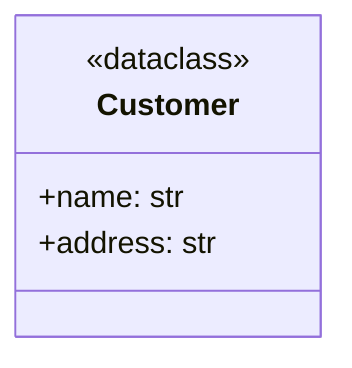
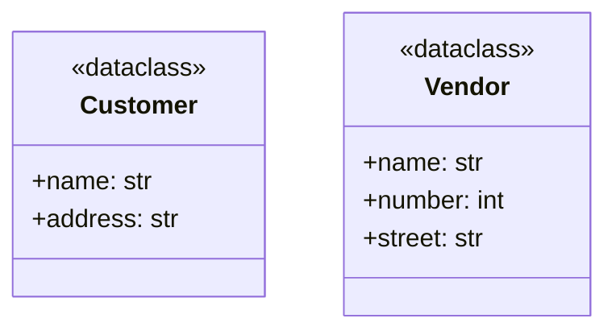
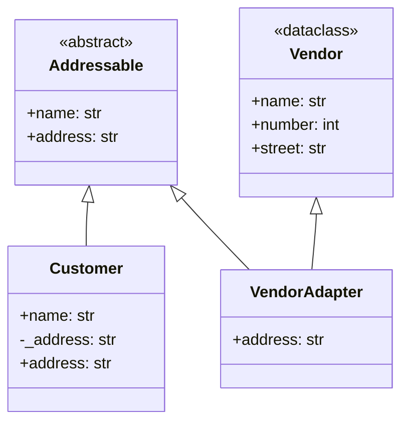
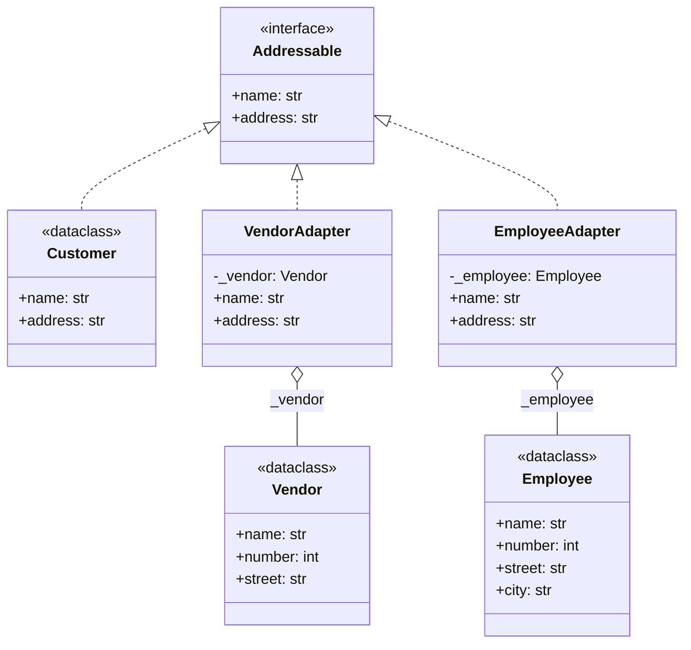

# Adapter (estructural)

> Hacé que una clase con una interfaz incompatible funcione donde el cliente
> espera otra, **sin modificar ninguna de las dos**.

## Archivos

El ejemplo recorre cuatro pasos.

| Archivo | Rol |
| --- | --- |
| [customers_before_adapter.py](customers_before_adapter.py) | Paso 1: el programa original solo conoce `Customer`, con un `address` combinado. |
| [customers_vendors_before_adapter.py](customers_vendors_before_adapter.py) | Paso 2, problema: llegan los `Vendor`, con `number` y `street` separados, y `describe` ramifica según el tipo de lista. |
| [customers_vendors_with_class_adapter.py](customers_vendors_with_class_adapter.py) | Paso 3, adapter de clase: `VendorAdapter` hereda de `Vendor` y de `Addressable` y solo agrega `address`. |
| [customers_vendors_with_object_adapter.py](customers_vendors_with_object_adapter.py) | Paso 4, adapter de objeto: `VendorAdapter` y `EmployeeAdapter` envuelven una instancia de `Vendor` o de `Employee` y la exponen como `Addressable`. |

```bash
uv run python -m structural.adapter.customers_before_adapter
uv run python -m structural.adapter.customers_vendors_before_adapter
uv run python -m structural.adapter.customers_vendors_with_class_adapter
uv run python -m structural.adapter.customers_vendors_with_object_adapter
```

## El problema (antes)

```python
def describe(kind: EntityKind) -> list[str]:
    if kind == "customers":
        return [
            f"Name: {customer.name}; Address: {customer.address}"
            for customer in CUSTOMERS
        ]
    if kind == "vendors":
        return [
            f"Name: {vendor.name}; Address: {vendor.number} {vendor.street}"
            for vendor in VENDORS
        ]
    raise ValueError(f"Incorrect type: {kind}")
```

- El cliente tiene que saber qué tipo de entidad recibió y cómo guarda la
  dirección cada uno.
- Un tipo nuevo (clientes gubernamentales, proveedores extranjeros) obliga
  a abrir `describe` otra vez.

## La solución (con el patrón)

```text
describe(entities) ──▶ Addressable (Target)
                          ▲              ▲
                     Customer      VendorAdapter ──hereda/envuelve──▶ Vendor (Adaptee)
```

- **Adapter de clase (paso 3):** `VendorAdapter(Vendor, Addressable)` reusa
  el `__init__` y el campo `name` del dataclass `Vendor`, que queda
  exactamente igual que en el paso 2.
- **Adapter de objeto (paso 4):** el adapter tiene un `Vendor`, así que
  sirve para cualquier instancia, incluidas sus subclases. `Addressable` es
  un `Protocol`: `Customer` y los adapters lo cumplen sin heredar.
- En los dos casos `describe` vuelve a ser un único bucle sobre una única
  interfaz.

## Diagramas de clases

Un diagrama por archivo, en el orden de la tabla. Las relaciones:

- `<|--` herencia y `<|..` implementación de un `Protocol`.
- `*--` composición (la clase crea y posee el objeto) y `o--` agregación
  (lo recibe desde afuera); `"*"` indica una colección.
- `..>` dependencia: la clase lo `crea`, lo `usa` en una firma o lo `lanza`.
- En los miembros, `-` es privado, `*` abstracto y `$` de clase o estático.

### [customers_before_adapter.py](customers_before_adapter.py)



### [customers_vendors_before_adapter.py](customers_vendors_before_adapter.py)



### [customers_vendors_with_class_adapter.py](customers_vendors_with_class_adapter.py)



### [customers_vendors_with_object_adapter.py](customers_vendors_with_object_adapter.py)



## Patrón para reutilizar

1. Definí la interfaz que el cliente necesita (Target).
2. Escribí un adapter por cada clase incompatible que traduzca sus datos o
   llamadas a esa interfaz.
3. Preferí el adapter de objeto (composición); usá el de clase solo si
   necesitás reusar mucho comportamiento del adaptado y controlás la
   jerarquía.

Plantilla tipada: [PATTERNS.md → Adapter](../../PATTERNS.md#adapter).

## Simplificaciones del ejemplo

- Los adapters son de un solo sentido: hacen que un vendor parezca un
  customer, no al revés.
- Los datos están en tuplas a nivel de módulo; en la práctica vendrían de
  APIs o bases de datos distintas.
