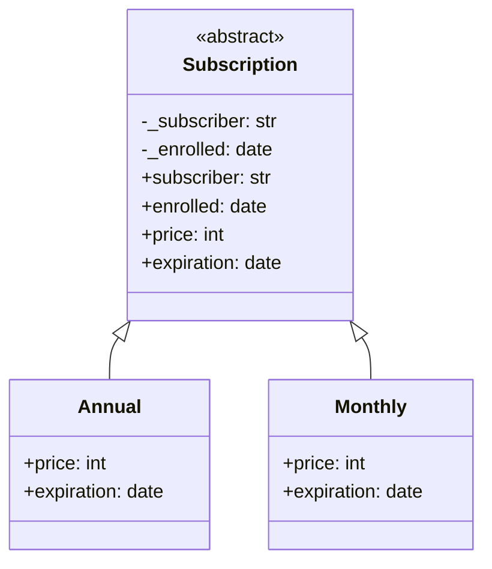
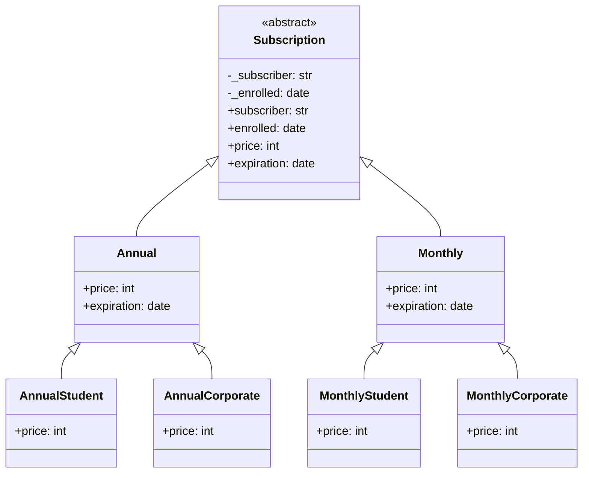
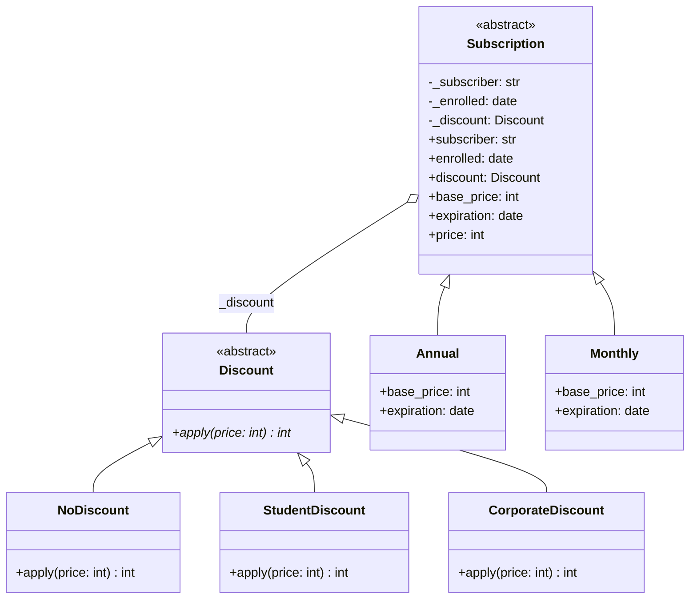

# Bridge (estructural)

> Cuando una jerarquía crece en **dos dimensiones independientes**, separala
> en dos jerarquías unidas por una referencia (el "puente").

## Archivos

| Archivo | Rol |
| --- | --- |
| [subscription_before_bridge.py](subscription_before_bridge.py) | Paso 1: `Subscription` con dos subclases, `Annual` y `Monthly`. Todavía no hay problema. |
| [subscription_discount_before_bridge.py](subscription_discount_before_bridge.py) | Paso 2, problema: los descuentos se agregan con más subclases (`AnnualStudent`, `AnnualCorporate`, `MonthlyStudent`, `MonthlyCorporate`). |
| [subscription_discount_with_bridge.py](subscription_discount_with_bridge.py) | Paso 3, solución: `Subscription` recibe un `Discount` (`NoDiscount`, `StudentDiscount`, `CorporateDiscount`) y le delega el precio final. |

```bash
uv run python -m structural.bridge.subscription_before_bridge
uv run python -m structural.bridge.subscription_discount_before_bridge
uv run python -m structural.bridge.subscription_discount_with_bridge
```

Los precios están en centavos `int`; los descuentos redondean hacia abajo al
centavo.

## El problema (antes)

```text
Subscription
   ▲                         ▲
 Annual                    Monthly
   ▲          ▲              ▲            ▲
AnnualStudent AnnualCorporate MonthlyStudent MonthlyCorporate
```

- Período y descuento comparten una jerarquía, así que las clases se
  multiplican: 2 períodos × 2 descuentos son cuatro clases nuevas.
- La regla del 10 % para estudiantes está duplicada en dos clases.
- El descuento queda fijo al definir la clase; no se puede elegir por
  suscripción en tiempo de ejecución.

## La solución (con el patrón)

```text
Subscription (Abstraction) ──tiene──▶ Discount (Implementor)
     ▲                                    ▲
Annual | Monthly           NoDiscount | StudentDiscount | CorporateDiscount
```

- Las clases crecen de forma aditiva: 2 períodos + 3 descuentos son 5
  clases, y cada descuento nuevo funciona con todos los períodos.
- El descuento se inyecta en cada suscripción y se puede testear aislado.

## Diagramas de clases

Un diagrama por archivo, en el orden de la tabla. Las relaciones:

- `<|--` herencia y `<|..` implementación de un `Protocol`.
- `*--` composición (la clase crea y posee el objeto) y `o--` agregación
  (lo recibe desde afuera); `"*"` indica una colección.
- `..>` dependencia: la clase lo `crea`, lo `usa` en una firma o lo `lanza`.
- En los miembros, `-` es privado, `*` abstracto y `$` de clase o estático.

### [subscription_before_bridge.py](subscription_before_bridge.py)



### [subscription_discount_before_bridge.py](subscription_discount_before_bridge.py)



### [subscription_discount_with_bridge.py](subscription_discount_with_bridge.py)



## Patrón para reutilizar

1. Detectá las dos dimensiones que varían por separado.
2. Dejá una como jerarquía principal (abstracción) y convertí la otra en
   una interfaz propia (implementor).
3. La abstracción recibe el implementor por constructor y le delega su
   parte del trabajo.

Plantilla tipada: [PATTERNS.md → Bridge](../../PATTERNS.md#bridge).

**Precaución:** con una sola dimensión real, el puente es indirección sin
beneficio. En este ejemplo el implementor tiene una sola operación, así que
se parece mucho a un Strategy; el Bridge se distingue cuando el implementor
ofrece varias operaciones primitivas que la abstracción combina.

## Simplificaciones del ejemplo

- `add_months` está copiado en los tres archivos para que cada uno sea
  autocontenido.
- La fecha de alta es fija (`ENROLLED`) para que la salida sea
  determinista.
