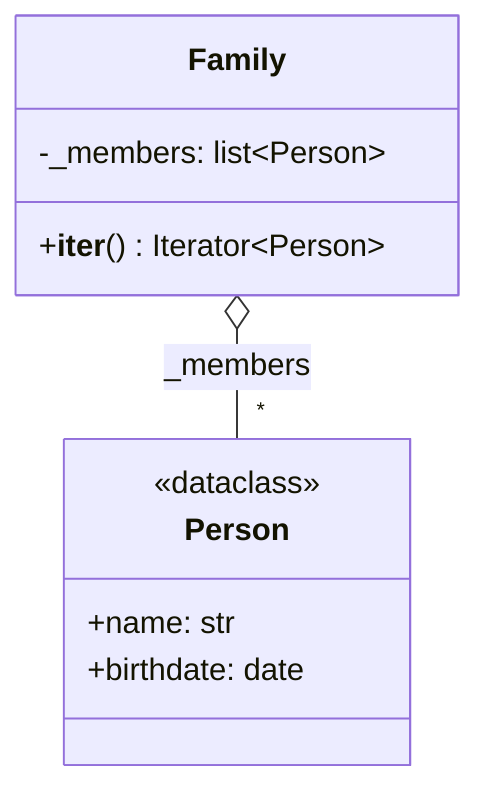
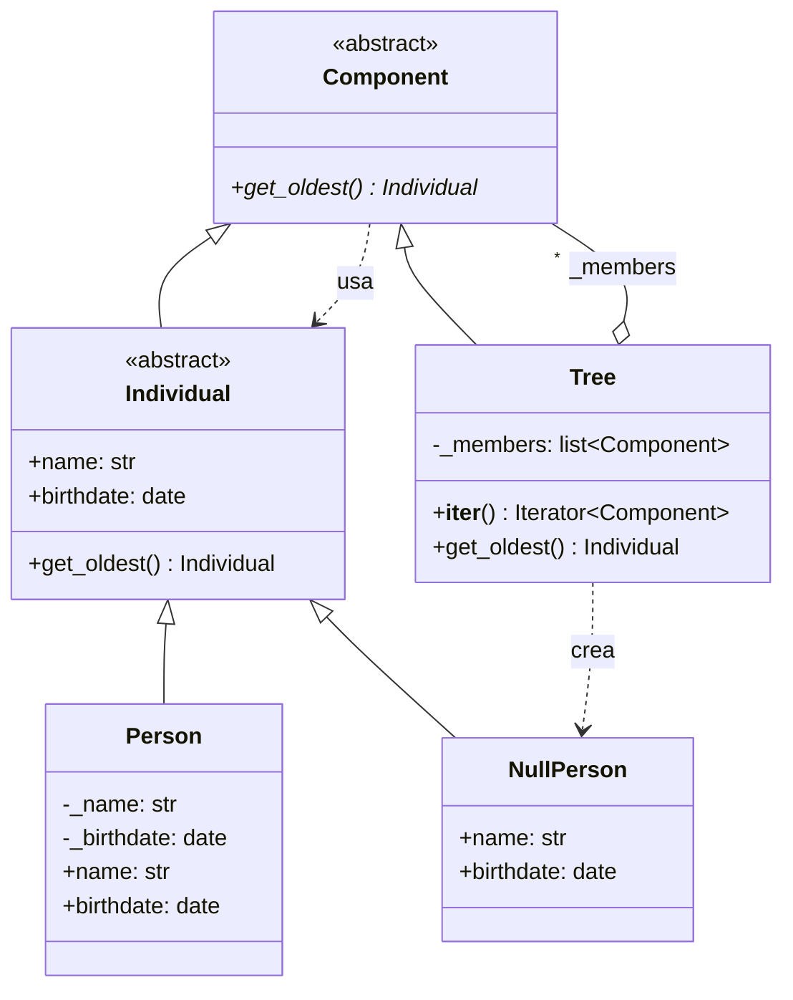

# Composite (estructural)

> Tratá **un objeto individual y un grupo de objetos** de la misma forma, con
> árboles anidados a cualquier profundidad.

## Archivos

| Archivo | Rol |
| --- | --- |
| [family_before_composite.py](family_before_composite.py) | Problema: `Family` y una lista de `Person` sueltos tienen interfaces distintas, y `find_oldest` repite el mismo bucle para cada uno. |
| [family_with_composite.py](family_with_composite.py) | Solución: `Person` (hoja) y `Tree` (compuesto) comparten `Component.get_oldest()`; `NullPerson` es lo que devuelve un árbol vacío. |

```bash
uv run python -m structural.composite.family_before_composite
uv run python -m structural.composite.family_with_composite
```

## El problema (antes)

```python
for member in family:
    if member.birthdate < earliest_date:
        oldest = member
        earliest_date = member.birthdate

for single in singles:
    if single.birthdate < earliest_date:
        oldest = single
        earliest_date = single.birthdate
```

- El cliente trata distinto cada estructura y escribe dos veces el mismo
  bucle de búsqueda.
- Un grupo no puede contener otro grupo: una familia de familias necesita
  otro bucle más.
- El cliente tiene que sembrar la búsqueda con `date.max` y manejar el caso
  "no hay nadie".

## La solución (con el patrón)

```text
client ──▶ Component.get_oldest()
              ▲                  ▲
         Individual            Tree (Composite) ──miembros──▶ Component
          ▲        ▲
   Person (Leaf)  NullPerson (Null Object)
```

- Una `Person` es la más vieja de su propio árbol de un nodo: devuelve
  `self`.
- Un `Tree` pregunta a cada miembro y se queda con la fecha más temprana;
  la recursión reemplaza los bucles duplicados.
- `NullPerson` es el `default` de `min()`, así que un árbol vacío devuelve
  un objeto válido en lugar de `None`.

## Diagramas de clases

Un diagrama por archivo, en el orden de la tabla. Las relaciones:

- `<|--` herencia y `<|..` implementación de un `Protocol`.
- `*--` composición (la clase crea y posee el objeto) y `o--` agregación
  (lo recibe desde afuera); `"*"` indica una colección.
- `..>` dependencia: la clase lo `crea`, lo `usa` en una firma o lo `lanza`.
- En los miembros, `-` es privado, `*` abstracto y `$` de clase o estático.

### [family_before_composite.py](family_before_composite.py)



### [family_with_composite.py](family_with_composite.py)



## Patrón para reutilizar

1. Definí una interfaz común con la operación que querés hacer sobre
   cualquier nodo.
2. Las hojas la implementan directamente; el compuesto la implementa
   delegando en sus hijos.
3. El compuesto acepta cualquier `Component` como hijo, así que los
   árboles se anidan sin límite.

Plantilla tipada: [PATTERNS.md → Composite](../../PATTERNS.md#composite).

**Precaución:** la interfaz común puede volverse demasiado general. Las
operaciones que solo tienen sentido en las hojas (aquí, `birthdate`) van en
un contrato aparte (`Individual`).

## Simplificaciones del ejemplo

- La edad se calcula contra una fecha fija (`REFERENCE_DATE`) para que la
  salida sea determinista.
- Los árboles se arman a mano en `client()`; no hay operaciones para agregar
  o quitar miembros después de crearlos.
