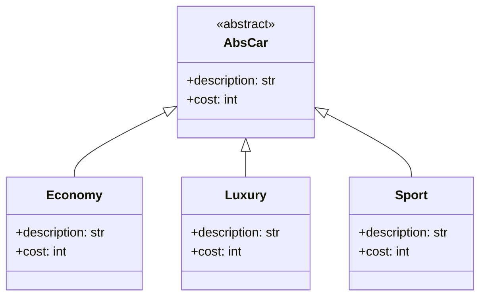
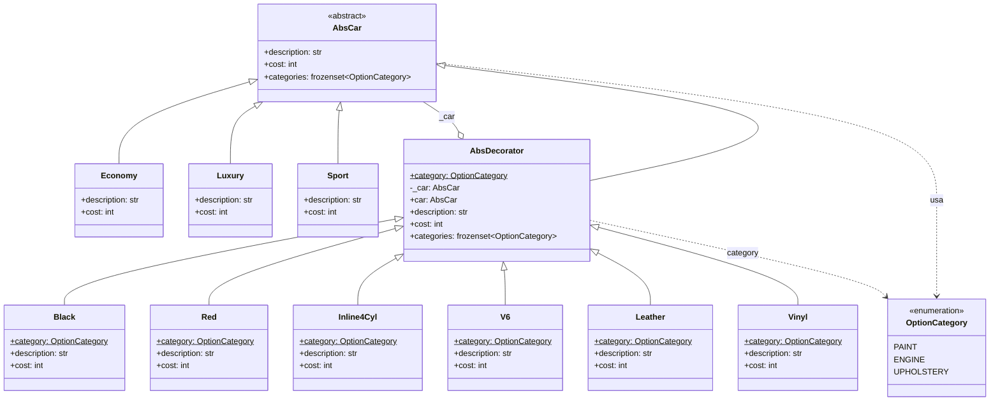
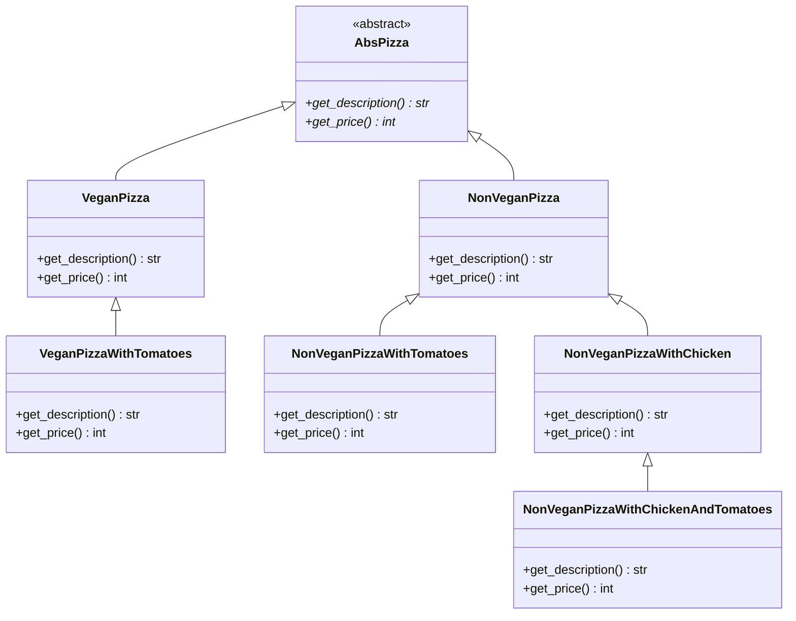
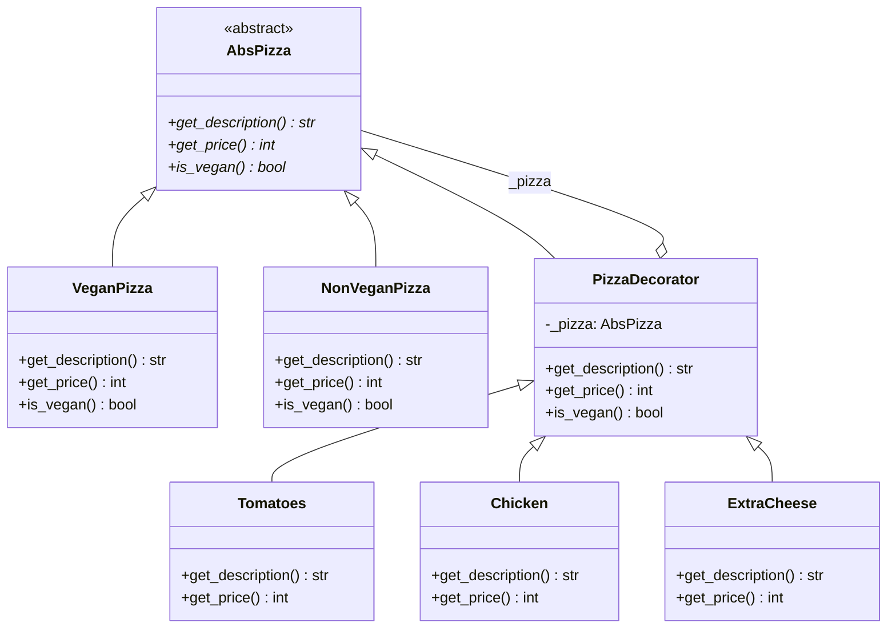

# Decorator (estructural)

> Agregá responsabilidades a **un objeto concreto en tiempo de ejecución**,
> envolviéndolo en otro objeto con la misma interfaz.

## Archivos

Hay dos ejemplos independientes: autos con opciones y pizzas con
ingredientes extra.

| Archivo | Rol |
| --- | --- |
| [cars_before_decorator.py](cars_before_decorator.py) | Problema: tres trims (`Economy`, `Luxury`, `Sport`) que heredan de `AbsCar`; cada combinación de opciones sería una subclase nueva. |
| [cars_with_decorator.py](cars_with_decorator.py) | Solución: cada opción (`Black`, `Red`, `Inline4Cyl`, `V6`, `Leather`, `Vinyl`) es un `AbsDecorator` de una `OptionCategory`; una segunda opción de la misma categoría se rechaza. |
| [pizza_before_decorator.py](pizza_before_decorator.py) | Problema: una subclase por combinación (`VeganPizzaWithTomatoes`, `NonVeganPizzaWithTomatoes`, `NonVeganPizzaWithChicken`, `NonVeganPizzaWithChickenAndTomatoes`). |
| [pizza_with_decorator.py](pizza_with_decorator.py) | Solución: `PizzaDecorator` y los ingredientes `Tomatoes`, `Chicken` y `ExtraCheese` se apilan sobre `VeganPizza` o `NonVeganPizza`; `Chicken` rechaza una pizza vegana. |

```bash
uv run python -m structural.decorator.cars_before_decorator
uv run python -m structural.decorator.cars_with_decorator
uv run python -m structural.decorator.pizza_before_decorator
uv run python -m structural.decorator.pizza_with_decorator
```

Los precios están en centavos `int`. Las versiones "con" terminan mostrando
un intento rechazado.

## El problema (antes)

```text
AbsPizza
  ▲                        ▲
VeganPizza               NonVeganPizza
  ▲                        ▲
VeganPizzaWithTomatoes   NonVeganPizzaWithTomatoes
                         NonVeganPizzaWithChicken
                           ▲
                         NonVeganPizzaWithChickenAndTomatoes
```

- Explosión de subclases: con los autos, 3 trims × 2 colores × 2 motores ×
  2 tapizados ya son 24 clases.
- La lógica de cada opción (por ejemplo, "agregar tomates") se repite en
  cada clase que la incluye.
- Las combinaciones quedan fijas al escribir la clase: no se puede agregar
  un ingrediente a una pizza que ya existe.

## La solución (con el patrón)

```text
AbsCar (Component)
  ▲                    ▲
Economy | Luxury     AbsDecorator ──envuelve──▶ AbsCar
| Sport                ▲
                 Black | Red | Inline4Cyl | V6 | Leather | Vinyl
```

- Cada decorador **es** un `AbsCar` y **tiene** un `AbsCar`, así que se
  pueden apilar: `Red(Leather(V6(Sport())))`.
- La base del decorador reenvía las llamadas por defecto y cada opción solo
  extiende lo que le toca.
- El costo de cada opción vive en un solo lugar.

## Diagramas de clases

Un diagrama por archivo, en el orden de la tabla. Las relaciones:

- `<|--` herencia y `<|..` implementación de un `Protocol`.
- `*--` composición (la clase crea y posee el objeto) y `o--` agregación
  (lo recibe desde afuera); `"*"` indica una colección.
- `..>` dependencia: la clase lo `crea`, lo `usa` en una firma o lo `lanza`.
- En los miembros, `-` es privado, `*` abstracto y `$` de clase o estático.

### [cars_before_decorator.py](cars_before_decorator.py)



### [cars_with_decorator.py](cars_with_decorator.py)



### [pizza_before_decorator.py](pizza_before_decorator.py)



### [pizza_with_decorator.py](pizza_with_decorator.py)



## Patrón para reutilizar

1. Definí la interfaz del componente.
2. Creá un decorador base que reciba un componente y le reenvíe todo.
3. Cada responsabilidad extra es un decorador concreto que extiende el
   resultado del componente envuelto.
4. Si hay combinaciones prohibidas, validalas en el constructor del
   decorador.

Plantilla tipada: [PATTERNS.md → Decorator](../../PATTERNS.md#decorator).

**Precaución:** las reglas que la jerarquía garantizaba por construcción
(un auto tiene un solo motor, una pizza vegana no lleva pollo) pasan a
validarse en tiempo de ejecución. Y el código que pregunta por el tipo
concreto (`isinstance`) deja de funcionar con un objeto decorado.

## Simplificaciones del ejemplo

- Los decoradores solo suman descripción y precio; cuando hacen más cosas,
  el orden en que se apilan puede importar.
- No hay forma de quitar un decorador una vez aplicado.
