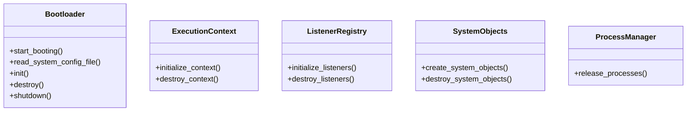
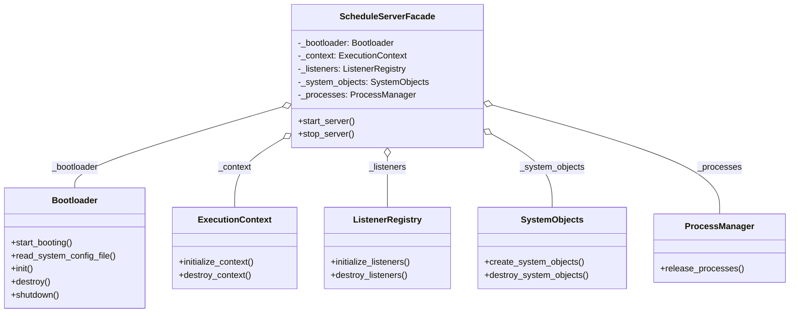

# Facade (estructural)

> Ofrecé **una interfaz simple** sobre un subsistema complejo, para que la
> mayoría de los clientes no tenga que conocer sus piezas.

## Archivos

| Archivo | Rol |
| --- | --- |
| [schedule_server_before_facade.py](schedule_server_before_facade.py) | Problema: el cliente arranca y detiene el servidor coordinando cinco clases (`Bootloader`, `ExecutionContext`, `ListenerRegistry`, `SystemObjects`, `ProcessManager`) en doce llamadas ordenadas. |
| [schedule_server_with_facade.py](schedule_server_with_facade.py) | Solución: `ScheduleServerFacade` recibe los cinco subsistemas y expone solo `start_server()` y `stop_server()`. |

```bash
uv run python -m structural.facade.schedule_server_before_facade
uv run python -m structural.facade.schedule_server_with_facade
```

Las dos versiones imprimen exactamente la misma secuencia de pasos.

## El problema (antes)

```python
bootloader.start_booting()
bootloader.read_system_config_file()
bootloader.init()
context.initialize_context()
listeners.initialize_listeners()
system_objects.create_system_objects()
...
```

- Cada cliente repite las secuencias de arranque y apagado, y el orden
  correcto queda duplicado en todos lados.
- Olvidar un paso o invertir dos deja el servidor a medio inicializar.
- Los clientes dependen de cada clase y cada método interno: renombrar o
  dividir un paso los rompe a todos.

## La solución (con el patrón)

```text
client ──▶ ScheduleServerFacade
             start_server() / stop_server()
                   │
                   ├──▶ Bootloader
                   ├──▶ ExecutionContext
                   ├──▶ ListenerRegistry
                   ├──▶ SystemObjects
                   └──▶ ProcessManager
```

- El orden de los pasos, que atraviesa varias clases, vive en un solo
  lugar.
- Los subsistemas no conocen la fachada y siguen disponibles para los
  pocos clientes que necesiten control fino.

## Diagramas de clases

Un diagrama por archivo, en el orden de la tabla. Las relaciones:

- `<|--` herencia y `<|..` implementación de un `Protocol`.
- `*--` composición (la clase crea y posee el objeto) y `o--` agregación
  (lo recibe desde afuera); `"*"` indica una colección.
- `..>` dependencia: la clase lo `crea`, lo `usa` en una firma o lo `lanza`.
- En los miembros, `-` es privado, `*` abstracto y `$` de clase o estático.

### [schedule_server_before_facade.py](schedule_server_before_facade.py)



### [schedule_server_with_facade.py](schedule_server_with_facade.py)



## Patrón para reutilizar

1. Identificá los casos de uso que la mayoría de los clientes necesita.
2. Creá una clase que reciba los subsistemas y exponga un método por caso
   de uso.
3. No escondas los subsistemas: la fachada simplifica el acceso, no lo
   prohíbe.

Plantilla tipada: [PATTERNS.md → Facade](../../PATTERNS.md#facade).

**Precaución:** una fachada que absorbe responsabilidades ajenas se vuelve
una god class. Si distintos clientes usan partes distintas del subsistema,
preferí varias fachadas chicas.

## Simplificaciones del ejemplo

- Cada paso solo imprime un mensaje; en un servidor real cada uno podría
  fallar, y la fachada sería el lugar natural para deshacer los pasos ya
  ejecutados.
