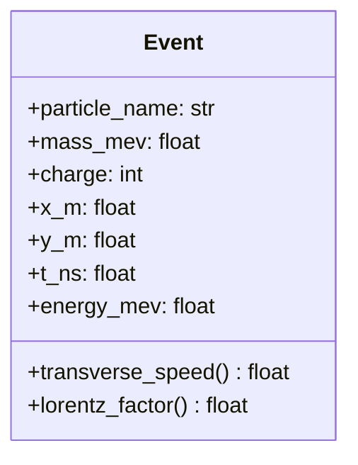
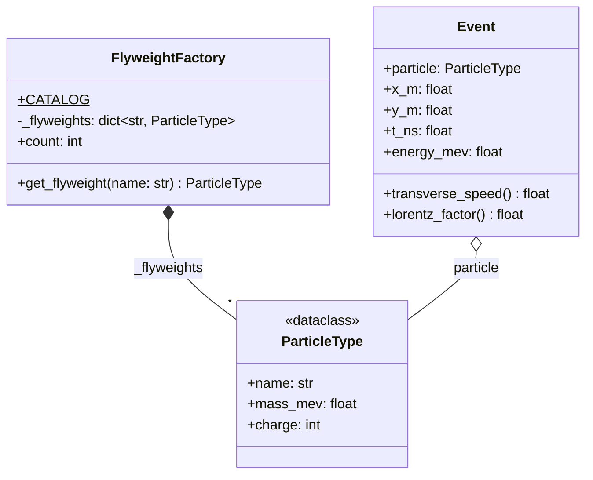

# Flyweight (estructural)

> Cuando hay muchísimos objetos parecidos, **compartí la parte que no
> cambia** (estado intrínseco) y dejá en cada objeto solo lo que varía
> (estado extrínseco).

## Archivos

| Archivo | Rol |
| --- | --- |
| [collider_events_before_flyweight.py](collider_events_before_flyweight.py) | Problema: cada `Event` se parsea de su propio registro de texto y guarda su propia copia del nombre, la masa y la carga de la partícula. |
| [collider_events_with_flyweight.py](collider_events_with_flyweight.py) | Solución: `FlyweightFactory` entrega un `ParticleType` congelado y compartido por todos los eventos de la misma partícula; `Event` solo guarda posición, tiempo y energía. |

```bash
uv run python -m structural.flyweight.collider_events_before_flyweight
uv run python -m structural.flyweight.collider_events_with_flyweight
```

Las dos versiones parsean los mismos 1000 registros e imprimen su tamaño
total, medido con la misma función `total_size()`.

## El problema (antes)

```text
Event(name, mass, charge, x, y, t, energy)   × 1000
      ^^^^^^^^^^^^^^^^^^
      mismos valores, una copia distinta en cada evento
```

- Los datos constantes se duplican una vez por evento.
- Nada garantiza la consistencia: dos eventos de la "misma" partícula
  podrían terminar con masas distintas.

## La solución (con el patrón)

```text
FlyweightFactory ──cachea──▶ ParticleType (frozen: name, mass, charge)
                                   ▲
Event (x, y, t, energy) ──referencia──┘
```

- La fábrica crea cada `ParticleType` la primera vez y después devuelve el
  mismo objeto, así que la identidad se conserva.
- Los dos `Event` usan `__slots__`, por lo que la diferencia de memoria se
  debe solo a compartir los datos de la partícula (unos 255 KB frente a
  unos 168 KB).

## Diagramas de clases

Un diagrama por archivo, en el orden de la tabla. Las relaciones:

- `<|--` herencia y `<|..` implementación de un `Protocol`.
- `*--` composición (la clase crea y posee el objeto) y `o--` agregación
  (lo recibe desde afuera); `"*"` indica una colección.
- `..>` dependencia: la clase lo `crea`, lo `usa` en una firma o lo `lanza`.
- En los miembros, `-` es privado, `*` abstracto y `$` de clase o estático.

### [collider_events_before_flyweight.py](collider_events_before_flyweight.py)



### [collider_events_with_flyweight.py](collider_events_with_flyweight.py)



## Patrón para reutilizar

1. Separá el estado del objeto en intrínseco (compartible) y extrínseco
   (propio de cada uso).
2. Hacé inmutable el estado intrínseco (`@dataclass(frozen=True)`).
3. Creá una fábrica que cachee los flyweights por clave.
4. Medí antes y después: el patrón solo vale la pena si la memoria es un
   problema real.

Plantilla tipada: [PATTERNS.md → Flyweight](../../PATTERNS.md#flyweight).

**Precaución:** un flyweight mutable filtraría cada cambio a todos los
objetos que lo referencian. Y la caché de este ejemplo nunca libera
entradas.

## Simplificaciones del ejemplo

- `total_size()` suma `sys.getsizeof` de cada objeto alcanzable por sus
  `__slots__`; es una aproximación, no una medición exacta del intérprete.
- Los registros se generan de forma determinista en lugar de leerse de un
  detector.
