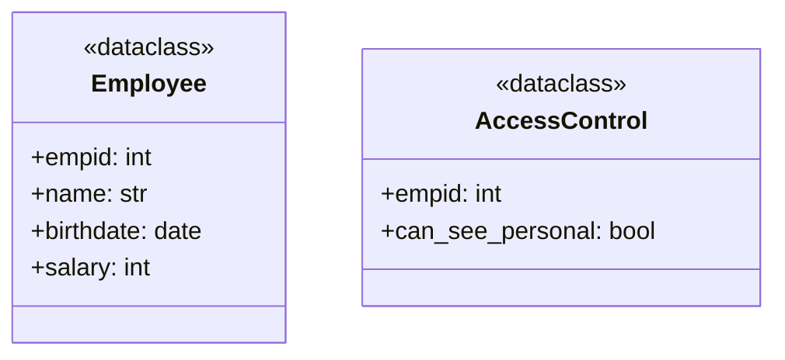
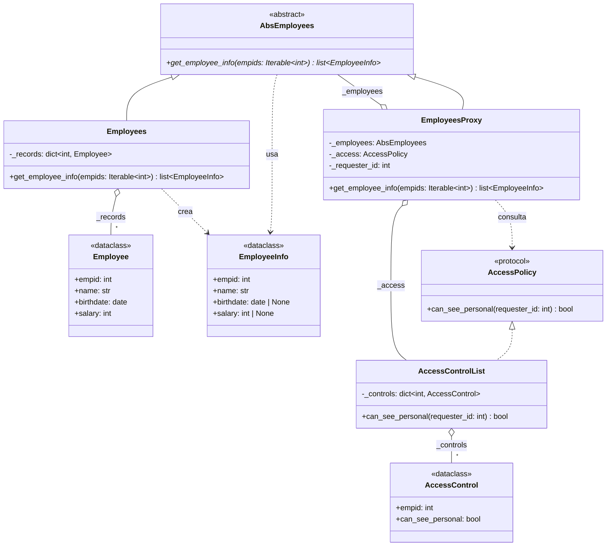

# Proxy (estructural)

> Poné un objeto con **la misma interfaz** delante del objeto real para
> controlar el acceso a él.

## Archivos

| Archivo | Rol |
| --- | --- |
| [employee_access_before_proxy.py](employee_access_before_proxy.py) | Problema: `employee_details` busca los registros de `Employee` y además aplica la regla de privacidad con los `AccessControl`. |
| [employee_access_with_proxy.py](employee_access_with_proxy.py) | Solución: `Employees` solo busca registros; `EmployeesProxy` implementa la misma `AbsEmployees` y oculta fecha de nacimiento y salario de `EmployeeInfo` según `AccessControlList`. |

```bash
uv run python -m structural.proxy.employee_access_before_proxy
uv run python -m structural.proxy.employee_access_with_proxy
```

Las dos versiones aplican la misma regla: solo quien tiene
`can_see_personal` ve los datos personales, ni siquiera los propios.

## El problema (antes)

```python
control = access.get(requester_id)
can_see_personal = control is not None and control.can_see_personal
lines: list[str] = []
for empid in empids:
    if empid not in employees:
        continue
    employee = employees[empid]
    details = f"Employee Id: {employee.empid}, Name: {employee.name}"
    if can_see_personal:
        details += (
            f", Birthdate: {employee.birthdate.isoformat()}"
            f", Salary: {format_cents(employee.salary)}"
        )
    lines.append(details)
```

- Una sola función busca los datos y aplica la regla de privacidad.
- Cualquier otro código que lea empleados tiene que acordarse de repetir el
  chequeo; si lo olvida, filtra salarios.
- La regla no se puede cambiar, registrar ni testear por separado.

## La solución (con el patrón)

```text
client ──▶ AbsEmployees (Subject)
              ▲               ▲
   EmployeesProxy ──▶ Employees (RealSubject)
        │
        ▼
 AccessPolicy (Protocol) ◀── AccessControlList
```

- El proxy y el objeto real implementan la misma interfaz, así que el
  cliente no los distingue.
- Cada clase tiene una sola responsabilidad: buscar datos o controlar el
  acceso.

## Diagramas de clases

Un diagrama por archivo, en el orden de la tabla. Las relaciones:

- `<|--` herencia y `<|..` implementación de un `Protocol`.
- `*--` composición (la clase crea y posee el objeto) y `o--` agregación
  (lo recibe desde afuera); `"*"` indica una colección.
- `..>` dependencia: la clase lo `crea`, lo `usa` en una firma o lo `lanza`.
- En los miembros, `-` es privado, `*` abstracto y `$` de clase o estático.

### [employee_access_before_proxy.py](employee_access_before_proxy.py)



### [employee_access_with_proxy.py](employee_access_with_proxy.py)



## Patrón para reutilizar

1. Extraé la interfaz del objeto real.
2. Creá un proxy que implemente esa interfaz y reciba el objeto real.
3. El proxy agrega el control (acceso, carga diferida, caché, registro) y
   delega el resto.
4. Entregale a los clientes el proxy, no el objeto real.

Plantilla tipada: [PATTERNS.md → Proxy](../../PATTERNS.md#proxy).

**Precaución:** el proxy tiene que seguir la interfaz del objeto real; cada
método nuevo hay que reenviarlo.

## Simplificaciones del ejemplo

- `client()` tiene el objeto real (`directory`) a mano, así que podría
  saltearse el proxy; en una aplicación real solo el proxy llegaría a los
  clientes.
- Los salarios están en centavos `int`.
